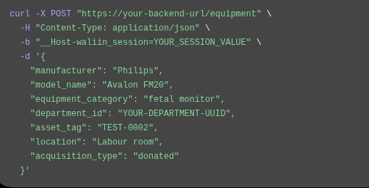

# API Reference

## 1. Introduction

This document describes the HTTP API exposed by the Waliin backend.

Waliin uses a FastAPI backend to provide API operations for authentication, user management, equipment registration, fault reporting, technical assessment, prioritisation, repair management, verification records, maintenance reporting, notifications and resource requests.

The API is described using the OpenAPI specification generated by FastAPI.

This reference documents the paths, HTTP methods, request parameters, request schemas and response models declared in the current OpenAPI specification.

## 2. API Information

| Property | Value |
|---|---|
| Application | Waliin |
| Framework | FastAPI |
| Declared specification version | 0.1.0 |
| OpenAPI version | 3.1.0 |
| Standard data format | JSON |
| File upload format | multipart/form-data |
| Health endpoint | `/health` |
| Interactive documentation | `/docs` |
| OpenAPI schema | `/openapi.json` |

The backend routes are registered through the FastAPI application.

The paths documented in this reference are the paths declared in the OpenAPI specification. The frontend may use `BACKEND_API_PREFIX` when configuring its API connection; this frontend setting should not be interpreted as an additional server-side route prefix.

### 2.1 HTTP response codes

The specification uses the following response codes across the documented operations:

| Status code | Meaning |
|---|---|
| 200 | Successful operation |
| 201 | Resource created |
| 202 | Request accepted for processing |
| 204 | Successful operation with no response body |
| 422 | Request validation error |

Not every endpoint declares every status code. Refer to the individual endpoint operation in Swagger UI for its declared responses.

## 3. Authentication Endpoints

Base path: `/auth`

| Method | Endpoint | Description | Request schema | Success response |
|---|---|---|---|---|
| POST | `/auth/login` | Authenticate a user | `LoginRequest` | `CurrentUser` — 200 |
| POST | `/auth/logout` | End the current session | None declared | 204 |
| GET | `/auth/me` | Retrieve the current user | None declared | `CurrentUser` — 200 |
| POST | `/auth/mfa/setup` | Begin MFA setup | None declared | Schema unspecified — 200 |
| POST | `/auth/mfa/confirm` | Confirm MFA setup | `MfaCodeRequest` | Schema unspecified — 200 |
| POST | `/auth/mfa/verify` | Verify an MFA code | `MfaCodeRequest` | Schema unspecified — 200 |
| POST | `/auth/accept-invite` | Accept a user invitation | `AcceptInviteRequest` | Schema unspecified — 200 |
| POST | `/auth/forgot-password` | Request a password reset | `ForgotPasswordRequest` | Schema unspecified — 202 |
| POST | `/auth/reset-password` | Reset a password | `ResetPasswordRequest` | Schema unspecified — 200 |

### 3.1 Authentication request schemas

| Schema | Declared fields |
|---|---|
| `LoginRequest` | `email`, `password` |
| `MfaCodeRequest` | `code` |
| `AcceptInviteRequest` | `token`, `full_name`, `password`, `confirm_password` |
| `ForgotPasswordRequest` | `email` |
| `ResetPasswordRequest` | `token`, `password`, `confirm_password` |

The OpenAPI specification does not declare a formal security scheme or operation-level security requirements. Session-cookie and authorization requirements should therefore be documented separately using the backend authentication implementation.

## 4. User Management Endpoints

Base path: `/users`

| Method | Endpoint | Description | Request schema | Success response |
|---|---|---|---|---|
| POST | `/users` | Invite a user | `InviteUserRequest` | `UserOut` — 201 |
| GET | `/users` | List users | Query parameters | Array of `UserOut` — 200 |
| PATCH | `/users/{user_id}` | Update a user | `UpdateUserRequest` | `UserOut` — 200 |
| POST | `/users/{user_id}/resend-invite` | Resend an invitation | None declared | `UserOut` — 200 |
| POST | `/users/{user_id}/revoke` | Revoke a user | None declared | `UserOut` — 200 |
| POST | `/users/{user_id}/send-reset-link` | Send a password reset link | None declared | Schema unspecified — 202 |

### 4.1 User list parameters

`GET /users` supports the following optional query parameters:

| Parameter | Type | Description |
|---|---|---|
| `role` | `UserRole` | Filter users by role |
| `department_id` | UUID | Filter users by department |

### 4.2 User request schemas

| Schema | Declared fields |
|---|---|
| `InviteUserRequest` | `email`, `role`, `department_id` |
| `UpdateUserRequest` | `role`, `department_id` |

The invitation and update request schemas allow the roles `clinical_staff` and `biomedical_engineer`.

The broader `UserRole` schema defines three roles:

- `clinical_staff`
- `biomedical_engineer`
- `health_manager`

## 5. Dashboard Endpoints

Base path: `/dashboard`

| Method | Endpoint | Description | Success response |
|---|---|---|---|
| GET | `/dashboard/summary` | Retrieve dashboard summary information | `DashboardSummary` — 200 |

The `DashboardSummary` response declares:

- `active_faults`
- `critical_faults`
- `high_priority_faults`
- `equipment_down`
- `equipment_under_maintenance`

## 6. Equipment Management Endpoints

Base path: `/equipment`

### 6.1 Department management

| Method | Endpoint | Description | Request schema | Success response |
|---|---|---|---|---|
| POST | `/equipment/departments` | Create a department | `DepartmentCreate` | `DepartmentResponse` — 201 |
| GET | `/equipment/departments` | List departments | None declared | Array of `DepartmentResponse` — 200 |
| GET | `/equipment/departments/{department_id}` | Retrieve a department | None declared | `DepartmentResponse` — 200 |
| PATCH | `/equipment/departments/{department_id}` | Update a department | `DepartmentUpdate` | `DepartmentResponse` — 200 |
| PATCH | `/equipment/departments/{department_id}/deactivate` | Deactivate a department | None declared | `DepartmentResponse` — 200 |

### 6.2 Equipment registration and management

| Method | Endpoint | Description | Request schema | Success response |
|---|---|---|---|---|
| POST | `/equipment` | Register equipment | `EquipmentCreate` | `EquipmentResponse` — 201 |
| GET | `/equipment` | List equipment | None declared | Array of `EquipmentResponse` — 200 |
| GET | `/equipment/pending` | List pending equipment | None declared | Array of `EquipmentResponse` — 200 |
| GET | `/equipment/out-of-service` | List out-of-service equipment | None declared | Array of `EquipmentResponse` — 200 |
| GET | `/equipment/mine` | List equipment associated with the current user | None declared | Array of `EquipmentResponse` — 200 |
| GET | `/equipment/{equipment_id}` | Retrieve equipment details | None declared | `EquipmentResponse` — 200 |
| PATCH | `/equipment/{equipment_id}` | Update equipment | `EquipmentUpdate` | `EquipmentResponse` — 200 |
| POST | `/equipment/{equipment_id}/approve` | Approve equipment | None declared | `EquipmentResponse` — 200 |
| POST | `/equipment/{equipment_id}/return` | Return equipment for correction | `EquipmentApprovalDecision` | `EquipmentResponse` — 200 |
| POST | `/equipment/{equipment_id}/resubmit` | Resubmit returned equipment | `EquipmentUpdate` | `EquipmentResponse` — 200 |

### 6.3 Equipment documents

| Method | Endpoint | Description | Request format | Success response |
|---|---|---|---|---|
| POST | `/equipment/{equipment_id}/documents` | Upload an equipment document | `multipart/form-data` | `DocumentResponse` — 201 |
| GET | `/equipment/documents/{doc_id}/download` | Download an equipment document | None declared | Response schema unspecified — 200 |
| DELETE | `/equipment/documents/{doc_id}` | Delete an equipment document | None declared | 204 |

The upload operation declares the following fields:

- `doc_type`
- `doc_name`
- `file`

The document response schema includes the document ID, equipment ID, document type, document name, storage key, uploader and upload timestamp.

The download operation does not currently declare a specific binary response media type in the OpenAPI specification.

### 6.4 Equipment CSV import

| Method | Endpoint | Description | Request format | Success response |
|---|---|---|---|---|
| POST | `/equipment/import-csv` | Import equipment records from a CSV file | `multipart/form-data` | Response schema unspecified — 200 |

The upload request contains a required `file` field.

## 7. Fault Management Endpoints

Base path: `/faults`

| Method | Endpoint | Description | Request schema | Success response |
|---|---|---|---|---|
| POST | `/faults/` | Create a fault report | `FaultCreate` | `FaultOut` — 201 |
| GET | `/faults/` | List fault reports | Query parameters | Array of `FaultOut` — 200 |
| GET | `/faults/{fault_id}` | Retrieve a fault report | None declared | `FaultOut` — 200 |
| POST | `/faults/{fault_id}/assign` | Assign a fault to an engineer | `FaultAssign` | `FaultOut` — 200 |
| POST | `/faults/{fault_id}/status` | Update fault status | `FaultStatusUpdate` | `FaultOut` — 200 |
| POST | `/faults/{fault_id}/close` | Close a fault report | `FaultClose` | `FaultOut` — 200 |

### 7.1 Fault list parameters

`GET /faults/` supports:

| Parameter | Type | Default |
|---|---|---|
| `skip` | Integer | 0 |
| `limit` | Integer | 100 |

### 7.2 Fault severity

The `FaultSeverity` schema defines:

- `low`
- `medium`
- `high`
- `critical`

### 7.3 Fault status

The `FaultStatus` schema defines:

- `reported`
- `assigned`
- `under_inspection`
- `awaiting_resources`
- `under_repair`
- `awaiting_verification`
- `verified`
- `closed`
- `cancelled`

## 8. Fault Assessment Endpoints

Base path: `/faults`

| Method | Endpoint | Description | Required header | Request schema | Success response |
|---|---|---|---|---|---|
| POST | `/faults/{fault_id}/assessments` | Create a fault assessment | `X-Engineer-Id` | `FaultAssessmentCreate` | `FaultAssessmentRead` — 201 |
| GET | `/faults/{fault_id}/assessments` | Retrieve fault assessments | `X-Engineer-Id` | None declared | Array of `FaultAssessmentRead` — 200 |

The `X-Engineer-Id` header is required by both operations and is declared as a UUID.

### 8.1 Fault assessment fields

The `FaultAssessmentCreate` schema declares:

- `findings`
- `condition`
- `recommended_action`
- `severity_factor`
- `clinical_criticality`
- `backup_available`
- `priority_level`
- `priority_explanation`

The `FaultAssessmentRead` response additionally includes:

- `assessment_id`
- `fault_id`
- `assessed_by`
- `assessed_at`
- `history_factor`
- `priority_score`
- `rule_priority_level`
- `rule_version`
- `is_current`

The priority levels are `low`, `medium`, `high` and `critical`.

## 9. Priority List Endpoints

Base path: `/faults`

| Method | Endpoint | Description | Success response |
|---|---|---|---|
| GET | `/faults/priority-list` | Retrieve the prioritised fault list | Array of `PriorityListItem` — 200 |

The `PriorityListItem` response includes:

- Fault and equipment identifiers
- Equipment name and asset tag
- Department name
- Fault status
- Priority score and priority level
- Priority explanation
- Severity factor
- Clinical criticality
- Backup availability
- Reported timestamp
- Downtime and current down status, when available
- Assigned engineer ID, when available

The specification exposes rule-based prioritisation fields. It does not describe a machine-learning prediction endpoint.

## 10. Repair Work Endpoints

Base path: `/faults`

| Method | Endpoint | Description | Required header | Request schema | Success response |
|---|---|---|---|---|---|
| POST | `/faults/{fault_id}/repairs` | Record repair work | `user-id` | `RepairCreate` | `RepairRecordResponse` — 200 |
| POST | `/faults/{fault_id}/tests` | Record a test | `user-id` | `TestCreate` | `RepairRecordResponse` — 200 |
| POST | `/faults/{fault_id}/release` | Record fault release | `user-id` | `ReleaseCreate` or null | `RepairRecordResponse` — 200 |
| GET | `/faults/{fault_id}/records` | Retrieve repair records | None declared | None | Array of `RepairRecordResponse` — 200 |

The `user-id` header is required by the three POST operations and is declared as a UUID.

### 10.1 Repair request schemas

`RepairCreate` declares:

- `work_performed`
- `parts_used`
- `repair_started_at`
- `repair_completed_at`

`TestCreate` declares:

- `record_type`
- `test_result`
- `test_details`

The permitted test record types are:

- `functional_test`
- `safety_test`
- `calibration`
- `performance_test`
- `commissioning`

The permitted test results are `pass` and `fail`.

`ReleaseCreate` declares the optional field `test_details`.

### 10.2 Repair record response

`RepairRecordResponse` includes the repair record ID, fault ID, equipment ID, record type, performer, performer role, work performed, parts used, repair timestamps, test result, test details, service authorization and release timestamp.

## 11. Repair Verification Record Endpoints

Base path: `/repair-verification-records`

| Method | Endpoint | Description | Required header | Request schema | Success response |
|---|---|---|---|---|---|
| POST | `/repair-verification-records/` | Create a verification record | `user-id` | `RepairVerificationRecordCreate` | `RepairVerificationRecordResponse` — 200 |
| GET | `/repair-verification-records/` | List verification records | `user-id` | Query parameters | Array of `RepairVerificationRecordResponse` — 200 |
| GET | `/repair-verification-records/{record_id}` | Retrieve a verification record | `user-id` | None declared | `RepairVerificationRecordResponse` — 200 |
| PUT | `/repair-verification-records/{record_id}` | Update a verification record | `user-id` | `RepairVerificationRecordUpdate` | `RepairVerificationRecordResponse` — 200 |
| DELETE | `/repair-verification-records/{record_id}` | Delete a verification record | `user-id` | None declared | 204 |

The `user-id` header is required for all five operations and is declared as a UUID.

### 11.1 List parameters

`GET /repair-verification-records/` supports:

| Parameter | Type | Default |
|---|---|---|
| `skip` | Integer | 0 |
| `limit` | Integer | 100 |

### 11.2 Verification record schemas

The create schema includes fault and equipment identifiers, record type, performer, performer role, repair information, test information, service authorization and timestamps.

The update schema allows optional updates to record type, work performed, parts used, repair timestamps, test result, test details, service authorization and release timestamps.

## 12. Maintenance Reporting Endpoints

Base path: `/reports`

| Method | Endpoint | Description | Success response |
|---|---|---|---|
| GET | `/reports/maintenance-summary` | Retrieve a maintenance summary | `MaintenanceReportSummary` — 200 |
| GET | `/reports/maintenance-summary/pdf` | Download a maintenance summary PDF | Response schema unspecified — 200 |

The maintenance summary contains:

- `faults`
- `priorities`
- `downtime`
- `repairs`
- `resource_requests`

The PDF endpoint does not currently declare a specific binary response media type in the OpenAPI specification.

## 13. Notification Endpoints

Base path: `/notifications`

| Method | Endpoint | Description | Request schema | Success response |
|---|---|---|---|---|
| POST | `/notifications/` | Create a notification | `NotificationCreate` | `NotificationRead` — 201 |
| GET | `/notifications/` | List notifications | None declared | Array of `NotificationRead` — 200 |
| GET | `/notifications/me` | Retrieve notifications for the current user | None declared | Array of `NotificationRead` — 200 |
| GET | `/notifications/{id}` | Retrieve a notification | None declared | `NotificationRead` — 200 |
| POST | `/notifications/{id}/read` | Mark a notification as read | None declared | `NotificationRead` — 200 |

The `NotificationCreate` schema declares:

- `recipient_user_id`
- `notification_type`
- `message`
- `related_equipment_id`
- `related_fault_id`
- `related_request_id`
- `channel`

The default channel is `in_app`.

The `NotificationRead` response includes notification identifiers, recipient, notification type, message, channel, creation timestamp, delivery timestamp and read timestamp.

## 14. Resource Request Endpoints

Base path: `/requests`

| Method | Endpoint | Description | Request schema | Success response |
|---|---|---|---|---|
| POST | `/requests` | Create a resource request | `ResourceRequestsCreate` | Schema unspecified — 200 |
| GET | `/requests` | List resource requests | None declared | Schema unspecified — 200 |
| GET | `/requests/overdue` | Retrieve overdue resource requests | None declared | Schema unspecified — 200 |
| GET | `/requests/{request_id}` | Retrieve a resource request | None declared | Schema unspecified — 200 |
| PATCH | `/requests/{request_id}` | Update a resource request | `ResourceRequestsUpdate` | Schema unspecified — 200 |
| POST | `/requests/{request_id}/decide` | Record a request decision | `ResourceRequestsDecide` | Schema unspecified — 200 |

### 14.1 Resource request headers

`POST /requests` declares an optional `user-id` header.

`POST /requests/{request_id}/decide` declares two optional headers:

- `x-user-role`
- `user-id`

These header declarations describe the current OpenAPI contract. They do not, by themselves, establish the complete authorization policy.

### 14.2 Resource request schemas

`ResourceRequestsCreate` declares:

- `request_type`
- `justification`
- `related_fault_id`
- `items`

`ResourceRequestsUpdate` allows optional updates to the request type, justification, related fault and items.

`ResourceRequestsDecide` declares:

- `approval_status`
- `manager_id`
- `decision_reason`

The current OpenAPI specification does not provide response models for the resource request operations listed above.

## 15. Request Item Endpoints

Base path: `/requests`

| Method | Endpoint | Description | Parameters | Success response |
|---|---|---|---|---|
| GET | `/requests/{request_id}/items` | Retrieve request items | `request_id` path parameter | Array of `RequestItemsResponse` — 200 |
| PATCH | `/requests/{request_id}/items/{item_id}` | Update a request item | `request_id`, `item_id` path parameters; optional `quantity_fulfilled` query parameter | `RequestItemsResponse` — 200 |

The `quantity_fulfilled` parameter is declared as a query parameter, not a JSON request body.

The `RequestItemsResponse` schema includes:

- `item_id`
- `request_id`
- `item_name_or_service`
- `technical_specifications`
- `quantity_requested`
- `quantity_approved`
- `quantity_fulfilled`

## 16. Request Follow-up Endpoints

| Method | Endpoint | Description | Request schema | Success response |
|---|---|---|---|---|
| POST | `/requests/{request_id}/follow-ups` | Create a follow-up record | `RequestFollowUpsCreate` | `RequestFollowUpsResponse` — 201 |
| GET | `/requests/{request_id}/follow-ups` | Retrieve request follow-ups | None declared | Array of `RequestFollowUpsResponse` — 200 |
| POST | `/follow-ups/{follow_up_id}/reply` | Record a follow-up reply | `RequestFollowUpsReply` | `RequestFollowUpsResponse` — 200 |
| PATCH | `/follow-ups/{follow_up_id}` | Update a follow-up record | `RequestFollowUpsUpdate` | `RequestFollowUpsResponse` — 200 |

The create follow-up operation declares optional `x-user-role` and `user-id` headers.

### 16.1 Follow-up request schemas

`RequestFollowUpsCreate` declares:

- `organisation`
- `channel`
- `sent_date`
- `sent_at`
- `next_follow_up_date`
- `note`

`RequestFollowUpsReply` declares:

- `reply_status`
- `reply_at`
- `note`

`RequestFollowUpsUpdate` allows updates to the organisation, channel, sent date, sent timestamp, next follow-up date, reply status, reply timestamp and note.

## 17. Health Check Endpoint

| Method | Endpoint | Description | Success response |
|---|---|---|---|
| GET | `/health` | Check backend application availability | Object containing string values — 200 |

The health endpoint currently returns:

```json
{
  "status": "ok"
}
```

### 17.1 Health Check Request Example

The following example demonstrates how to call the Waliin health endpoint and inspect its JSON response.



## 18. Request Validation and Error Responses

FastAPI declares a validation error response for many operations that accept request bodies or parameters.

The OpenAPI validation error schema is `HTTPValidationError`.

It contains a `detail` array. Each validation error may include:

- `loc` — location of the invalid value
- `msg` — validation message
- `type` — validation error type
- `input` — supplied input, when available
- `ctx` — additional validation context, when available

The backend also implements service-level error handling. The service error response format should be documented alongside the backend exception handler implementation.

The frontend API client includes an `ApiError` class for handling HTTP errors.

## 19. Authentication and Authorization Notes

The current OpenAPI specification does not declare:

- A `securitySchemes` object.
- A global `security` requirement.
- Operation-level security requirements.

Some operations explicitly declare identity or role headers, including:

- `X-Engineer-Id`
- `user-id`
- `x-user-role`

The specification does not establish the full authentication or authorization requirements for every endpoint.

For the session-cookie implementation, role permissions, MFA enforcement and access restrictions, refer to the separate Authentication and Security documentation and the backend implementation.

## 20. OpenAPI Specification Limitations

The current specification has several areas that should be improved as the backend API evolves.

### 20.1 Missing response schemas

The following resource request operations currently have unspecified response schemas:

- `POST /requests`
- `GET /requests`
- `GET /requests/overdue`
- `GET /requests/{request_id}`
- `PATCH /requests/{request_id}`
- `POST /requests/{request_id}/decide`

The following operations also have unspecified or generic response schemas:

- `POST /auth/mfa/setup`
- `POST /auth/mfa/confirm`
- `POST /auth/mfa/verify`
- `POST /auth/accept-invite`
- `POST /auth/forgot-password`
- `POST /auth/reset-password`
- `POST /users/{user_id}/send-reset-link`
- `POST /equipment/import-csv`
- `GET /equipment/documents/{doc_id}/download`
- `GET /reports/maintenance-summary/pdf`

### 20.2 File response definitions

The document download and PDF report operations should declare their actual response media types and binary content schemas.

### 20.3 Security definitions

The API specification should describe the actual session authentication mechanism and the relevant security requirements so that the Swagger interface can communicate them accurately.

These are documentation and OpenAPI contract gaps. They do not automatically mean that the corresponding backend functionality is missing.

## 21. Related Documentation

- [Backend Documentation](backend-documentation.md)
- [Authentication and Security](authentication-and-security.md)
- [Database Design](database-design.md)
- [System Architecture](architecture.md)
- [Technical Reference](technical-reference.md)

## 22. Interactive API Explorer

Waliin provides interactive API documentation through Swagger UI.

Developers can use Swagger UI to:

- Explore registered API endpoints.
- Inspect request parameters and request bodies.
- Review declared response schemas.
- Inspect HTTP methods and status codes.
- Test API operations through the interactive interface.

**Interactive API documentation:**

[Open Waliin Swagger UI](https://waliin-8c96dd4bd190.herokuapp.com/docs)

**OpenAPI specification:**

[View the Waliin OpenAPI JSON](https://waliin-8c96dd4bd190.herokuapp.com/openapi.json)
