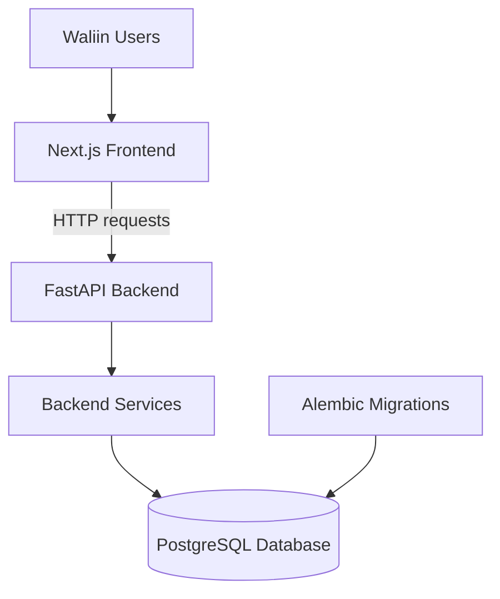
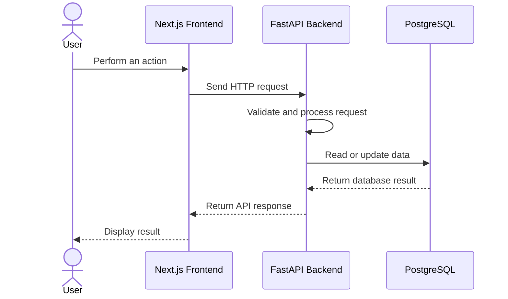

# System Architecture

## 1. Introduction

Waliin is a healthcare equipment management system developed by Solvya. Its architecture separates the user interface, backend application logic and persistent data storage.

The system supports equipment registration, fault reporting, technical assessment, repair tracking, verification and maintenance reporting.

## Documentation evidence status

This architecture page documents the intended system structure and project-level design patterns represented in this repository. It is best understood as a design reference and documentation artifact, not a complete runtime-verification of the live application implementation.

Claims about specific services, routes, database objects, environment variables, or deployment topology should be confirmed against the authoritative implementation repository before being treated as final system truth.

The principal application components are:

- Next.js frontend
- FastAPI backend
- PostgreSQL database
- SQLAlchemy database integration
- Alembic database migrations

## 2. High-Level Architecture

The frontend communicates with the backend through HTTP API requests. The backend processes application operations and interacts with the PostgreSQL database.

## 3. System Architecture Diagram (SAD)

The System Architecture Diagram illustrates the high-level structure of Waliin and the interactions between its users, frontend applications, functional modules, backend API, database and file storage.

The system supports three primary user groups:

- Clinical Staff
- Biomedical Engineers
- Health Managers

Clinical Staff and Biomedical Engineers interact with the Progressive Web Application (PWA), while Health Managers use the administrative Dashboard.

The Waliin API acts as the central backend interface, coordinating communication between the frontend applications, functional modules, PostgreSQL database and file storage.

### 3.1 System Architecture Overview

*Figure 1: Waliin System Architecture Diagram.*

### 3.2 Functional Modules

The architecture identifies the following functional modules:

1. Fault Reporting Module
2. Equipment Prioritization Module
3. Inspection Logging Module
4. Document Upload Module
5. Repair and Verification Module
6. Equipment Register Module
7. Resource Request Module
8. Notification Module
9. Report Generation Module
10. Authentication and User Management Module

## 4. Backend Architecture

The Waliin backend is built with Python and FastAPI. The main application is initialized in `main.py` and registers the API routers.

### 4.1 Backend Responsibilities

- Authenticate users and manage sessions.
- Manage user accounts and roles.
- Register and manage medical equipment.
- Process equipment fault reports.
- Support technical assessments.
- Record repair activities and tests.
- Manage repair verification records.
- Generate maintenance summaries and PDF reports.

### 4.2 Main Backend Components

| Component | Responsibility |
|---|---|
| `main.py` | Initializes the FastAPI application |
| `routers/` | Defines HTTP API endpoints |
| `services/` | Implements application operations |
| SQLAlchemy | Database integration |
| Alembic | Database schema migrations |
| Pydantic | Request and response validation |

### 4.3 Registered Router Groups

The FastAPI application registers 14 router groups covering the system's backend functionality:

1. Authentication
2. Users
3. Dashboard
4. Equipment
5. Priority List
6. Fault Assessment
7. Repair Verification Records
8. Maintenance Reports
9. Repair Work
10. Fault Management
11. Notifications
12. Resource Requests
13. Request Items
14. Request Follow-ups

The registered router groups represent backend API organization and are distinct from the ten functional modules shown in the System Architecture Diagram.

## 5. Database Architecture

Waliin uses PostgreSQL for persistent application data.

SQLAlchemy provides database integration, while Alembic manages database schema migrations.

The database contains entities for:

- Users
- Departments
- Equipment
- Equipment documents
- Faults
- Fault assessments
- Fault status history
- Repair verification records
- Resource requests
- Request items
- Request follow-ups
- Notifications
- Audit logs

The database also uses relationships, constraints, indexes, triggers and a fault downtime view.

See [Database Design](database-design.md) for detailed table definitions and relationships.

## 6. Application Request Flow

A typical interaction between a user and Waliin follows this sequence:

1. A user opens the Waliin frontend.
2. The frontend sends an HTTP request to the backend API.
3. FastAPI routes the request to the appropriate endpoint.
4. The backend validates the request data.
5. Application logic processes the requested operation.
6. SQLAlchemy is used to interact with PostgreSQL when data access is required.
7. The backend returns a response to the frontend.
8. The frontend updates the interface using the response.

## 7. Architecture Resources

The following resources provide additional architecture documentation and system design references.

- [System Architecture Document (SAD)](https://lucid.app/lucidspark/c514bf5a-3b14-4c6c-b55a-40c42683a937/edit?invitationId=inv_5ca95f78-77cc-4f3d-863f-3e820f957649&page=0_0#)
- [Software System Architecture Document (SSAD)](https://www.figma.com/board/tYkPMimzCkAXrX8OZTOQpa/Solvya-SSAD?node-id=0-1&p=f)
