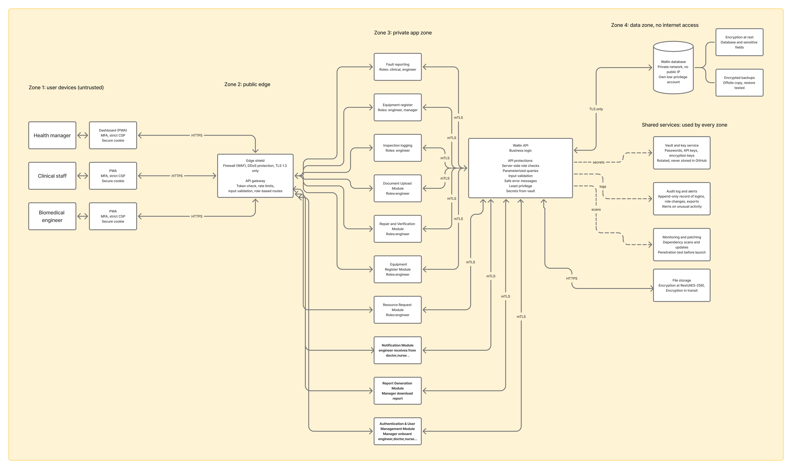
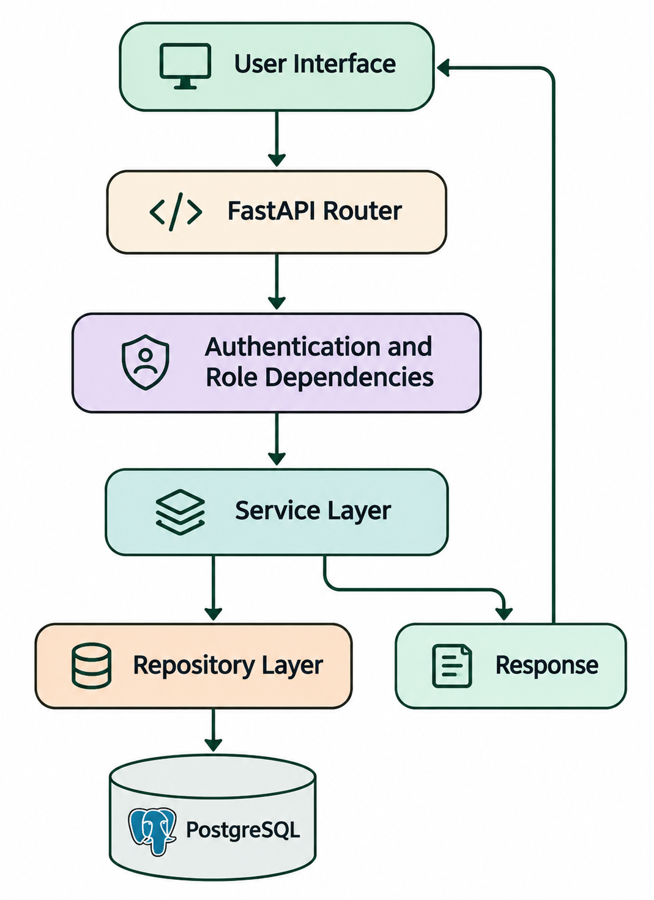

# System Architecture

## 1. Introduction

Waliin is a healthcare equipment management system developed by Solvya. Its architecture separates user interaction, application processing and persistent data storage.

The system supports medical equipment registration, fault reporting, equipment prioritization, technical inspection, document management, repair tracking, verification and maintenance reporting.

### 1.1 Architectural Scope

This document describes the high-level architecture of Waliin, including:

- System components and their responsibilities.
- System users and their interactions with the platform.
- Frontend applications and their relationship with the backend.
- Communication between major system components.
- Functional modules and their responsibilities.
- High-level system interactions and information flows.
- Architectural decisions and constraints.

Detailed backend implementation, database structures, API specifications, frontend implementation and deployment procedures are documented separately.

### 1.2 Documentation Evidence Status

This architecture document describes the intended system structure and project-level design represented in the project documentation.

It serves as a design reference and does not constitute complete runtime verification of the deployed application.

Claims about specific services, routes, database objects, environment variables or deployment topology should be confirmed against the authoritative implementation repositories before being treated as verified implementation details.

## 2. System Context

Waliin provides a shared platform for coordinating healthcare equipment management activities between Clinical Staff, Biomedical Engineers and Health Managers.

The system supports three primary user groups:

- **Clinical Staff:** Use the Progressive Web Application (PWA) to report equipment faults and view reported equipment information.
- **Biomedical Engineers:** Use the PWA to register equipment, access equipment information, assess reported faults, document inspection findings, record repair activities and manage equipment maintenance processes.
- **Health Managers:** Use the administrative Dashboard to oversee equipment registrations, manage users, review requests, monitor maintenance activities and access management reports.

Clinical Staff and Biomedical Engineers interact with the platform through their respective PWA interfaces, while Health Managers use the administrative Dashboard.

The frontend applications communicate with the central Waliin API, which coordinates application operations and interactions with persistent data storage and file storage.

## 3. High-Level System Architecture

Waliin follows a layered application structure that separates user interaction, application processing and data persistence.

The architecture consists of the following major components:

| Component | Architectural Responsibility |
|---|---|
| Clinical Staff PWA | Provides the interface for reporting equipment faults and accessing reported equipment information. |
| Biomedical Engineer PWA | Provides the interface for equipment registration, inspection, assessment, repair documentation and equipment maintenance activities. |
| Health Manager Dashboard | Provides administrative functionality for equipment oversight, user management, request management and reporting. |
| Waliin API | Acts as the central backend interface, coordinating communication between the frontend applications, functional modules and supporting resources. |
| PostgreSQL Database | Provides persistent storage for application data. |
| File Storage | Supports the storage and retrieval of uploaded equipment documents and related files. |

The frontend applications communicate with the Waliin API through HTTP API requests.

The API coordinates application operations through the system's functional modules and interacts with PostgreSQL and file storage when data persistence or document management is required.

The separation of these components establishes distinct responsibilities for user interaction, application processing and data management.

## 4. System Architecture Diagrams

### 4.1 System Architecture Diagram (SAD)

The System Architecture Diagram illustrates the high-level structure of Waliin and the interactions between its users, frontend applications, functional modules, backend API, PostgreSQL database and file storage.

*Figure 1: Waliin System Architecture Diagram.*

The diagram presents the relationships between the three primary user groups and the major components of the Waliin platform.

The architecture consists of:

- **User Layer:** Clinical Staff, Biomedical Engineers and Health Managers.
- **Presentation Layer:** Clinical Staff PWA, Biomedical Engineer PWA and Health Manager Dashboard.
- **Application Layer:** Waliin API and its functional modules.
- **Data and Storage Layer:** PostgreSQL database and file storage.

The Waliin API acts as the central backend interface, coordinating communication between the frontend applications, functional modules, PostgreSQL database and file storage.

### 4.2 Secure System Architecture Diagram (SSAD)

The Secure System Architecture Diagram illustrates the security-oriented view of Waliin. It divides the system into four security zones.

#### Zone 1 – User Devices

This zone represents user-facing devices and interfaces used by:

- Health Managers.
- Clinical Staff.
- Biomedical Engineers.

#### Zone 2 – Public Edge

This zone represents the public-facing security boundary between user devices and the private application environment.

The diagram identifies components such as:

- Edge protection.
- Web Application Firewall (WAF).
- DDoS protection.
- API Gateway.

#### Zone 3 – Private Application Zone

This zone contains the Waliin API and the functional application modules responsible for processing application operations.

#### Zone 4 – Data Zone

This zone represents the database and protected data storage components.

The SSAD also illustrates shared security services, including:

- Secrets management.
- Audit logging.
- Monitoring.
- Patching.
- File storage.

*Figure 2: Waliin Secure System Architecture Diagram.*

**Security architecture note:** The SSAD is an architectural design reference. Controls shown in the diagram, including mTLS, WAF protection, private database networking, encrypted backups and security scanning, should be verified against the actual deployment configuration before being described as operational controls.

### 4.3 Backend Request Flow

The following diagram provides a simplified view of how a request moves through the Waliin backend layers, from the user interface through routing, authentication and authorization dependencies, service processing and repository access.

*Figure 3: Simplified Waliin backend request flow.*

This flow is a conceptual representation of the backend's layered responsibilities.

Refer to the Backend Documentation for detailed implementation information about routers, services, repositories and database integration.

### 4.4 Functional Modules

The architecture identifies ten functional modules responsible for supporting the major equipment management activities within Waliin.

#### 4.4.1 Fault Reporting Module

Supports the submission and retrieval of medical equipment fault reports.

Clinical Staff use this module to submit equipment fault details and access information about reported equipment issues.

#### 4.4.2 Equipment Prioritization Module

Supports the prioritization of medical equipment based on equipment-related information and defined prioritization criteria.

The module provides prioritized equipment information to support biomedical engineers in identifying equipment requiring attention.

#### 4.4.3 Inspection Logging Module

Supports the recording and retrieval of equipment inspection information.

Biomedical Engineers use this module to document inspection details and access previously recorded inspection information.

#### 4.4.4 Document Upload Module

Supports the upload, storage and retrieval of equipment-related documents.

The module coordinates document information and file storage through the Waliin API.

#### 4.4.5 Repair and Verification Module

Supports the documentation of equipment repair activities, testing and verification records.

Biomedical Engineers use this module to record repair work, test results and equipment release information.

#### 4.4.6 Equipment Register Module

Supports the registration and retrieval of medical equipment information.

Biomedical Engineers use this module to submit new equipment details and access existing equipment records.

#### 4.4.7 Resource Request Module

Supports the submission and management of resource requests related to equipment maintenance.

The module allows requests to be submitted and supports their review, approval, return and status tracking.

#### 4.4.8 Notification Module

Supports the retrieval and display of in-app notifications.

Notifications provide users with information about relevant activities and updates within the platform.

#### 4.4.9 Report Generation Module

Supports the generation and retrieval of equipment and maintenance reports.

Health Managers can request and access PDF reports containing relevant equipment and maintenance information.

#### 4.4.10 Authentication and User Management Module

Supports user authentication and user management activities.

The module handles authentication-related requests and supports the management of user accounts and roles.

## 5. System Interaction and Data Flow

Waliin coordinates equipment management activities through communication between users, frontend applications, functional modules, the central API and supporting data storage components.

The following workflows describe the major interactions represented in the System Architecture Diagram.

### 5.1 Equipment Fault Reporting Flow

1. Clinical Staff access the Waliin PWA.
2. The user identifies the affected medical equipment.
3. The user enters the required equipment fault details.
4. The PWA sends the fault information to the Fault Reporting Module through the Waliin API.
5. The module processes the equipment fault information.
6. Reported equipment information is retrieved and made available through the PWA.

### 5.2 Equipment Prioritization Flow

1. Biomedical Engineers access the Waliin PWA.
2. The PWA requests equipment prioritization information.
3. The Equipment Prioritization Module retrieves the relevant prioritized equipment data through the Waliin API.
4. The prioritized equipment list is returned to the frontend.
5. Biomedical Engineers access the prioritized equipment information.

### 5.3 Equipment Inspection Flow

1. Biomedical Engineers access equipment inspection functionality through the PWA.
2. The engineer enters equipment inspection details.
3. The inspection information is submitted through the Inspection Logging Module.
4. The module communicates with the Waliin API to process the inspection information.
5. Equipment inspection details are retrieved and displayed through the PWA.

### 5.4 Equipment Document Management Flow

1. Biomedical Engineers access equipment documentation functionality.
2. The user selects and uploads equipment-related documents.
3. The Document Upload Module receives the document information.
4. The Waliin API coordinates document storage through the file storage component.
5. The document list and associated files are made available through the frontend.

### 5.5 Equipment Registration Flow

1. Biomedical Engineers access the equipment registration functionality through the PWA.
2. The engineer enters the required equipment details.
3. The information is submitted through the Equipment Register Module.
4. The module communicates with the Waliin API.
5. Equipment information is stored and retrieved through the application.
6. The registered equipment information becomes available through the platform according to the applicable registration workflow.

### 5.6 Repair and Verification Flow

1. Biomedical Engineers access the repair and verification functionality.
2. The engineer records repair activities and equipment test results.
3. The information is submitted through the Repair and Verification Module.
4. The module communicates repair and test records to the Waliin API.
5. Repair and verification information is retrieved.
6. The PWA displays repair history and equipment release status.

### 5.7 Resource Request Flow

1. A user submits a resource request through the appropriate frontend interface.
2. The request is submitted through the Resource Request Module.
3. The Waliin API coordinates the processing of the request.
4. Resource request information is retrieved and made available through the application.
5. The request can be reviewed, approved, returned or updated through the applicable management workflow.
6. Request status information is displayed to the relevant users.

### 5.8 Notification Flow

1. A frontend application requests notification information.
2. The request is handled through the Notification Module.
3. The module communicates with the Waliin API.
4. In-app notification information is returned.
5. The frontend displays the available notifications to the user.

### 5.9 Report Generation Flow

1. Health Managers access the administrative Dashboard.
2. A manager requests an equipment or maintenance report.
3. The request is submitted through the Report Generation Module.
4. The module communicates with the Waliin API to retrieve the required report data.
5. The generated report information is returned to the Dashboard.
6. The manager can access and download the PDF report.

### 5.10 Authentication and User Management Flow

1. Health Managers access the administrative Dashboard.
2. Users sign in through the authentication interface.
3. Authentication and user management requests are submitted through the Authentication and User Management Module.
4. The module communicates with the Waliin API.
5. Authentication results and user-related information are returned to the frontend.
6. The Dashboard displays relevant user information and invitation status.

## 6. Architectural Decisions and Constraints

### 6.1 Layered Application Structure

Waliin separates user interaction, application processing and persistent data storage into distinct architectural layers.

This separation establishes clear responsibilities for the frontend applications, backend application and supporting data storage components.

### 6.2 Separation of User Interfaces

Waliin provides separate frontend interfaces for its primary user groups:

- Clinical Staff PWA.
- Biomedical Engineer PWA.
- Health Manager Dashboard.

Each interface supports activities associated with the respective user's responsibilities within the equipment management process.

### 6.3 Centralized Backend Communication

The Waliin API serves as the central communication interface between the frontend applications, functional modules and supporting storage components.

This establishes a common application interface for coordinating system operations.

### 6.4 Persistent Data and File Storage

Waliin uses PostgreSQL for persistent application data and a separate file storage component for equipment-related documents.

This separates structured application information from uploaded files and documents.

### 6.5 Technology Choices

The principal technologies represented in the project architecture are:

| Technology | Architectural Role |
|---|---|
| Next.js | Frontend application framework |
| FastAPI | Backend application framework |
| PostgreSQL | Relational database |
| SQLAlchemy | Database integration |
| Alembic | Database schema migrations |

Detailed implementation and configuration information is documented in the respective technical sections.

### 6.6 Architectural Constraints

The architecture document describes the intended system structure and documented project design.

Specific implementation details and deployment characteristics must be verified against the authoritative application repositories.

The architecture document does not independently establish runtime availability, production infrastructure or external service integrations.

## 7. Architecture Resources

The following resources provide additional architecture documentation and system design references.

- [System Architecture Document (SAD)](https://lucid.app/lucidspark/c514bf5a-3b14-4c6c-b55a-40c42683a937/edit?invitationId=inv_5ca95f78-77cc-4f3d-863f-3e820f957649&page=0_0#)
- [Software System Architecture Document (SSAD)](https://www.figma.com/board/tYkPMimZcAXrX8OZTOQpa/Solvya-SSAD?node-id=0-1&p=f)
