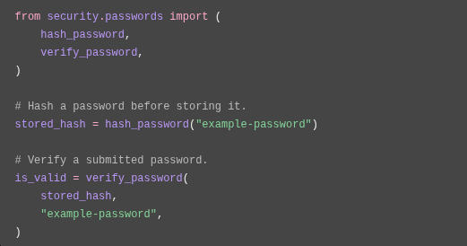
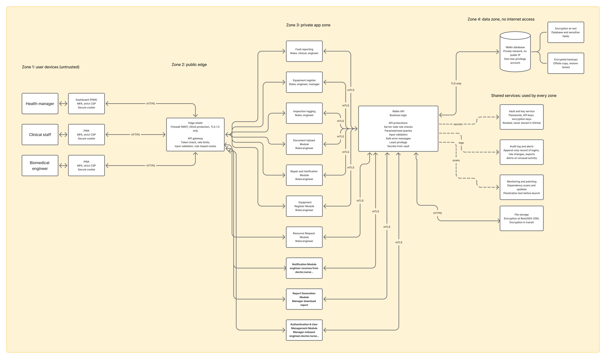

# Authentication and Security

## 1. Introduction

Waliin uses a backend authentication and authorization system to control access to application functionality and protect user accounts.

Authentication is implemented through the FastAPI backend. The frontend communicates with authentication endpoints through its API client.

The backend uses session-based authentication, role-based authorization, password hashing, and multi-factor authentication to protect application access.

This document describes the authentication mechanisms, authorization controls, session management, and security considerations implemented in Waliin.

The backend uses session-based authentication, role-based access controls, password hashing and multi-factor authentication to protect application access.

## 2. User Roles

The backend defines three user roles:

| Role | Description |
|---|---|
| `health_manager` | Health management user responsible for administrative and management activities. |
| `biomedical_engineer` | Biomedical engineering user responsible for equipment management, technical assessments, and repair activities. |
| `clinical_staff` | Clinical staff user responsible for reporting equipment faults and accessing relevant equipment information. |

These roles identify the categories of users supported by the application.

The backend uses role-related authorization dependencies to restrict access to protected operations.

## 3. Authentication Features

The backend provides the following authentication functionality:

- User login and logout.
- Retrieving the currently authenticated user.
- Multi-factor authentication setup.
- Multi-factor authentication confirmation.
- Multi-factor authentication verification.
- Invitation acceptance.
- Password reset requests.
- Password reset completion.

These operations are implemented through the authentication router.

For endpoint paths, HTTP methods, request parameters, and response details, refer to the [API Reference](api-reference.md).

## 4. Session Management

The backend uses session-based authentication through a secure session cookie.

The session cookie is named:

`__Host-waliin_session`

The cookie is configured with the following security attributes:

| Attribute | Configuration |
|---|---|
| Secure | Enabled |
| HttpOnly | Enabled |
| SameSite | Strict |
| Path | `/` |
| Idle timeout | 15 minutes |
| Maximum session lifetime | 8 hours |

### 4.1 Session Security Controls

The backend implements the following session protections:

- **Secure cookie:** The cookie is configured to be transmitted over secure connections.
- **HttpOnly:** Prevents client-side JavaScript from directly accessing the session cookie.
- **SameSite Strict:** Restricts cross-site cookie transmission.
- **Session expiration:** Sessions expire after 15 minutes of inactivity or a maximum lifetime of 8 hours.
- **Session-token hashing:** Session tokens are stored as hashes rather than plaintext values.
- **Account status validation:** Inactive accounts have their sessions ended.
- **MFA verification:** The current-user dependency checks whether required MFA verification has been completed.

These controls help protect authenticated sessions and reduce the risk of unauthorized account access.

## 5. Password Security

The backend uses Argon2 password hashing through the `pwdlib` library.

Password hashing protects stored password credentials by avoiding storage of passwords as plain text.

The system stores password hashes rather than original passwords.

### 5.1 Password Hashing Implementation Example

The following example illustrates the password hashing and verification functions used in Waliin.

The example demonstrates:

- Importing the password hashing helper functions.
- Generating a password hash before storage.
- Verifying a submitted password against the stored hash.

Argon2 provides password hashing designed to make password guessing more computationally expensive.

## 6. Multi-Factor Authentication

Waliin implements multi-factor authentication (MFA) through the authentication API.

The backend supports six-digit Time-Based One-Time Password (TOTP) verification.

MFA functionality includes:

- Starting MFA setup.
- Confirming MFA setup.
- Verifying MFA during authentication.

### 6.1 MFA Secret Protection

The backend encrypts stored MFA secrets using AES-256-GCM.

The encryption key is supplied through application configuration rather than being embedded directly in application code.

This protects stored MFA secrets from being exposed as readable values in the database.

## 7. Authorization and User Access

Waliin uses role-based authorization to control access to application functionality.

The three supported roles are:

- `health_manager`
- `biomedical_engineer`
- `clinical_staff`

Role-based dependencies in the backend restrict access to operations according to the required role.

The frontend also uses role information to determine the navigation and user experience presented after login.

Authorization decisions must be enforced by the backend rather than relying solely on frontend navigation or hidden interface elements.

The exact permissions for individual endpoints should be checked against their corresponding backend authorization dependencies.

For endpoint-level information, refer to the [API Reference](api-reference.md).

## 8. Login Attempt Protection

The backend implements a login-attempt limiter to restrict repeated authentication attempts.

The limiter maintains its state in application memory.

Consequently:

- Login-attempt state does not persist across server restarts.
- The limiter is application-level rather than distributed.
- Its state is not automatically shared between multiple application instances.

This distinction is important when considering security controls in a multi-instance production deployment.

## 9. Security Configuration

Security-related application settings are managed through backend configuration.

These include:

- Session cookie settings.
- Session idle timeout and maximum lifetime.
- MFA encryption key.
- MFA issuer configuration.
- Application environment settings.

Sensitive configuration values should be supplied through the deployment environment and should not be committed to source control.

Refer to the [Deployment Guide](deployment-guide.md) for deployment-related configuration information.

## 10. Security Considerations

The implemented authentication and session controls provide a foundation for protecting Waliin user accounts and application access.

The following areas should also be considered during security review and deployment:

- Verify that backend authorization is enforced for every protected operation.
- Ensure production deployments use HTTPS.
- Keep encryption keys and other secrets outside source control.
- Review session expiration and account deactivation behaviour.
- Test MFA setup, confirmation, and verification flows.
- Test login-attempt limiting and its behaviour across application restarts.
- Ensure diagnostic logs do not expose passwords, session tokens, or encryption keys.
- Review database and uploaded-document access permissions.

These are security review considerations and should not be interpreted as confirmation that every item is already implemented.

## 11. Related Documentation

- [Backend Documentation](backend-documentation.md)
- [API Reference](api-reference.md)
- [Database Design](database-design.md)
- [System Architecture](architecture.md)
- [Deployment Guide](deployment-guide.md)

## 12. Security Architecture Resource

The following Software System Architecture Document (SSAD) provides an additional reference for Waliin's security architecture.

It illustrates the security zones, application boundaries, data protection components, and shared security services represented in the system design.

### 12.1 Secure System Architecture Diagram (SSAD)

*Figure: Waliin Secure System Architecture Diagram.*

The diagram represents the proposed security architecture. Its individual controls should be verified against the deployed application and infrastructure before being described as operationally implemented.

### 12.2 External Architecture Resource

[Open Waliin SSAD – Figma](https://www.figma.com/board/tYkPMimZcAXrX8OZTOQpa/Solvya-SSAD?node-id=0-1&p=f)
