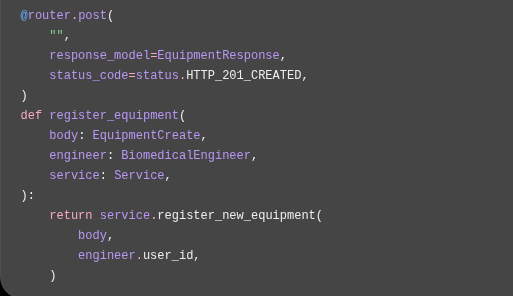

# Backend Documentation

## 1. Introduction

The Waliin backend is a REST API built with Python and FastAPI. It supports the management and tracking of medical equipment lifecycles in Ethiopian hospitals.

The backend provides application functionality for equipment registration and approval, fault reporting, fault assessment, repair management, maintenance reporting, dashboard summaries, resource requests and user management.

### 1.1 Purpose

This document describes the backend implementation of Waliin, including:

- Backend architecture and project structure.
- Technologies and supporting libraries.
- Application initialization and configuration.
- Organization of routers, schemas, services and repositories.
- HTTP request processing.
- Database integration.
- File and document handling.
- Error handling and validation.
- Backend testing and code quality.

Detailed endpoint specifications, database structures, authentication mechanisms and deployment procedures are documented separately.

### 1.2 Application Details

| Property | Value |
|---|---|
| Application Name | Waliin |
| Version | 0.1.0 |
| Programming Language | Python 3.11+ |
| Framework | FastAPI |
| Database ORM | SQLAlchemy |
| Database | PostgreSQL |
| API Style | REST |

## 2. Backend Architecture

The Waliin backend follows a layered architecture that separates HTTP request handling, data validation, business logic and database operations.

This organization provides distinct responsibilities for different backend components and supports the separation of application concerns.

### 2.1 Main Backend Components

| Component | Responsibility |
|---|---|
| `main.py` | Initializes the FastAPI application and registers API routers. |
| `routers/` | Defines API endpoints and handles HTTP requests. |
| `schemas/` | Defines request validation and response structures using Pydantic. |
| `services/` | Implements application operations and business logic. |
| `repositories/` | Handles database access and persistence operations. |
| `models/` | Defines SQLAlchemy database models. |
| `security/` | Contains authentication and security-related functionality. |
| `alembic/` | Manages database schema migrations. |
| `tests/` | Contains automated backend tests. |
| `templates/` | Contains email templates. |

### 2.2 Separation of Responsibilities

The backend components work together to process application requests.

- **Routers:** Receive HTTP requests, identify the required operation and coordinate the response.
- **Schemas:** Validate incoming data and define the structure of response objects.
- **Services:** Execute application operations and business rules.
- **Repositories:** Handle data access and persistence operations.
- **Models:** Represent database entities through SQLAlchemy.
- **Security:** Provides authentication and security-related functionality.

This separation keeps HTTP handling, application logic and database access organized into distinct components.

## 3. Technology Stack

The backend uses the following technologies and libraries.

### 3.1 Core Technologies

| Technology | Purpose |
|---|---|
| Python | Backend programming language |
| FastAPI | REST API framework |
| Uvicorn | ASGI application server |
| Pydantic | Data validation and serialization |
| Pydantic Settings | Application configuration |

### 3.2 Database Technologies

| Technology | Purpose |
|---|---|
| PostgreSQL | Relational database |
| SQLAlchemy | ORM and database interaction |
| Psycopg | PostgreSQL connectivity |
| Alembic | Database schema migrations |

### 3.3 Authentication and Security Libraries

| Technology | Purpose |
|---|---|
| PyJWT | JWT-related functionality |
| pwdlib with Argon2 | Password hashing |
| Cryptography | Cryptographic operations |

### 3.4 Supporting Libraries and Tools

| Technology | Purpose |
|---|---|
| Redis | Redis integration support |
| ReportLab | PDF generation |
| python-multipart | Multipart form and file uploads |
| pytest | Automated testing |
| pytest-cov | Test coverage reporting |
| Ruff | Python linting and formatting |

## 4. Application Structure

The backend application is initialized through `main.py`, which creates the FastAPI application and registers the available API routers.

The application uses separate directories for routing, validation, business logic, database access, models and security-related functionality.

### 4.1 Application Entry Point

The main application is initialized in `main.py`.

It defines the FastAPI application with the following metadata:

- Title: Waliin
- Version: 0.1.0
- Description: Backend API for tracking medical equipment lifecycles in Ethiopian hospitals.

The entry point also registers the application's API routers and defines the application-level health-check endpoint.

**Backend implementation example:**



<small>Figure 1: Example of backend implementation code.</small>

### 4.2 Router Organization

The backend organizes HTTP endpoints into router groups based on application functionality.

The main application registers 14 router groups using FastAPI's `app.include_router()` mechanism.

The registered groups are:

1. Authentication
2. Users
3. Dashboard
4. Equipment
5. Priority List
6. Fault Assessments
7. Repair Verification Records
8. Maintenance Reports
9. Repair Work
10. Fault Management
11. Notifications
12. Resource Requests
13. Request Items
14. Request Follow-ups

Each router groups related endpoints and delegates application operations to the relevant service and repository components.

Individual endpoint paths, HTTP methods, request parameters and response structures are documented in the API Reference.

### 4.3 Schema Organization

The `schemas/` directory contains Pydantic schemas used for request validation and response serialization.

Schemas define the expected structure of incoming data and the information returned by the API.

This provides a consistent data contract between the API and its clients.

### 4.4 Service Layer

The `services/` directory contains application operations and business logic.

Services coordinate the processing of application requests and interact with repository components when database access is required.

Examples of backend service responsibilities include:

- Equipment management.
- Fault assessment.
- Repair operations.
- Maintenance reporting.
- Notification management.
- Resource request processing.
- Dashboard summary generation.

### 4.5 Repository Layer

The `repositories/` directory handles database access and persistence operations.

Repository components separate data access responsibilities from the application logic implemented in services.

### 4.6 Model Organization

The `models/` directory contains SQLAlchemy models representing application database entities.

These models provide the ORM representation of the application's persistent data.

Detailed entity definitions, attributes and relationships are documented in Database Design.

### 4.7 Security Components

The `security/` directory contains authentication and security-related functionality.

This includes components used by the application to support user authentication and access restrictions.

Detailed authentication flows, session management, role-based access control and security controls are documented in Authentication and Security.

## 5. Application Configuration

The main FastAPI application is initialized in `main.py`.

The application registers its routers and configures application-level request handling.

### 5.1 Router Registration

The application uses `app.include_router()` to register the 14 router groups.

Each router exposes related endpoints for a particular area of backend functionality.

The router registration process makes these endpoints available through the FastAPI application.

### 5.2 Health Check

The application exposes a health-check endpoint:

| Method | Endpoint | Response |
|---|---|---|
| GET | `/health` | `{"status": "ok"}` |

This endpoint provides a basic application health response.

### 5.3 Application Dependencies

The backend uses FastAPI dependencies to provide shared functionality to API operations.

These dependencies support application operations such as database session management and user-related request handling.

### 5.4 Exception Handling

The application implements a custom exception handler for `ServiceError`.

The handler returns a JSON response containing the error message:

`{"detail": error.message}`

The HTTP status code is obtained from the exception's `status_code` property.

## 6. Request Processing Lifecycle

A typical backend request follows a layered processing sequence.

### 6.1 Request Processing Flow

1. A client sends an HTTP request to an API endpoint.
2. The corresponding router receives the request.
3. Pydantic schemas validate incoming data and define response structures.
4. The service layer processes the requested business operation.
5. Repository and model components support database operations when required.
6. The router returns the appropriate response to the client.

### 6.2 Component Interaction

The request processing lifecycle separates the responsibilities of the different backend layers.

| Stage | Component | Responsibility |
|---|---|---|
| Request handling | Router | Receives and processes HTTP requests. |
| Validation | Schema | Validates request data. |
| Application processing | Service | Executes business logic. |
| Data access | Repository | Handles persistence operations. |
| Data representation | Model | Represents database entities. |
| Response generation | Router and Schema | Returns structured API responses. |

Not every request requires database access. The processing sequence depends on the operation being performed.

## 7. Database Integration

The backend uses PostgreSQL for persistent application data.

SQLAlchemy provides the ORM functionality used by the application to interact with the database.

Alembic manages database schema migrations.

Detailed database entities, relationships, constraints, indexes, triggers and views are documented in Database Design.

### 7.1 Database Connectivity

Database connectivity is configured in `database.py`.

The database module:

- Loads environment variables using `python-dotenv`.
- Reads the database connection string from `DATABASE_URL`.
- Creates a SQLAlchemy engine when the database URL is available.
- Configures `SessionLocal` for database sessions.
- Defines the declarative `Base` used by ORM models.
- Provides a `get_db()` dependency for database session management.

### 7.2 Database Session Management

The `get_db()` function manages database sessions for requesting operations.

Its processing sequence is:

1. A database session is created.
2. The session is provided to the requesting operation.
3. The operation performs the required database interaction.
4. The session is closed in a `finally` block.

This ensures that the session is closed after the operation completes.

### 7.3 Database Migrations

Alembic manages database schema migrations.

The migration configuration is stored in `alembic.ini`, while migration environment configuration is defined in `alembic/env.py`.

The migration environment imports the application's SQLAlchemy metadata and supports online and offline migration execution.

## 8. File and Document Handling

The backend supports file-related operations associated with medical equipment management.

The equipment functionality includes endpoints for uploading, downloading and deleting equipment documents.

The backend also supports CSV-based equipment import.

### 8.1 File Upload Processing

The backend uses `python-multipart` to support multipart form and file upload requests.

Equipment document uploads are handled through the equipment API functionality.

The upload operation processes equipment-related documents through the backend.

### 8.2 Document Retrieval

The equipment API includes functionality for retrieving and downloading uploaded equipment documents.

Document retrieval is handled through the backend rather than requiring clients to interact directly with the underlying storage implementation.

### 8.3 CSV Equipment Import

The backend provides CSV-based equipment import functionality through the equipment API.

This supports the submission of equipment information through an uploaded CSV file.

Detailed file storage configuration and upload validation rules should be documented against their respective implementation components.

## 9. Error Handling and Validation

The backend uses Pydantic for request validation and response serialization.

FastAPI handles HTTP request processing, while the application also implements custom service-level error handling.

### 9.1 Request Validation

Incoming request data is validated using Pydantic schemas.

These schemas define the expected data structures and validation requirements for application operations.

### 9.2 Service-Level Errors

The application implements a custom `ServiceError` exception handler.

The handler:

- Retrieves the error message.
- Uses the exception's HTTP status code.
- Returns a JSON response containing the error detail.

Example response:

`{"detail": "Error message"}`

The actual error message and HTTP status depend on the exception raised by the application.

### 9.3 HTTP Responses

The backend returns HTTP responses according to the operation being performed.

Responses may contain structured JSON data, error details or generated files.

For example, the maintenance report PDF endpoint returns a `StreamingResponse` with the media type `application/pdf`.

## 10. Testing and Code Quality

The backend uses pytest for automated testing.

The test directory is organized into separate areas covering different aspects of the application.

### 10.1 Test Organization

The existing test directories include:

| Directory | Testing Focus |
|---|---|
| `auth_tests/` | Authentication functionality |
| `equipment_tests/` | Equipment-related functionality |
| `model_tests/` | Database model functionality |
| `security_tests/` | Security-related functionality |
| `session_tests/` | Session management functionality |

### 10.2 Testing Framework

The backend uses:

- **pytest:** Executes automated tests.
- **pytest-cov:** Supports test coverage reporting.

### 10.3 Code Quality

The project uses Ruff for Python linting and formatting.

The project configuration specifies:

- Python 3.11 as the Ruff target.
- An 88-character line length.

These settings support consistent Python code formatting and static code checks.

### 10.4 Running Backend Tests

The backend test suite can be executed using:

```bash
uv run --active pytest -q