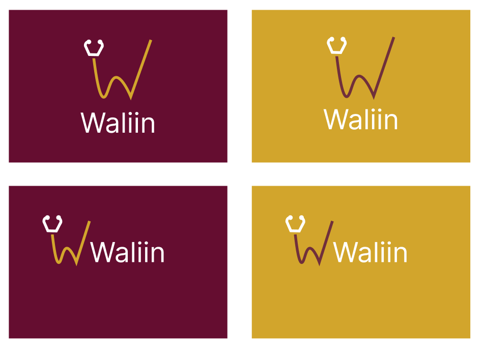
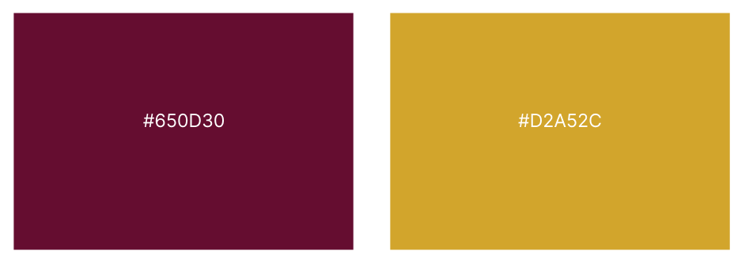
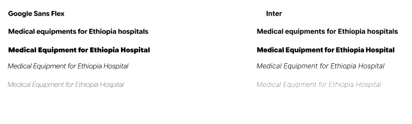
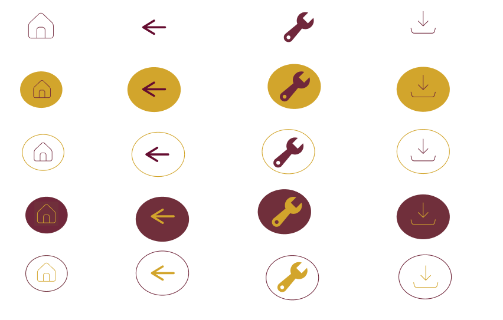
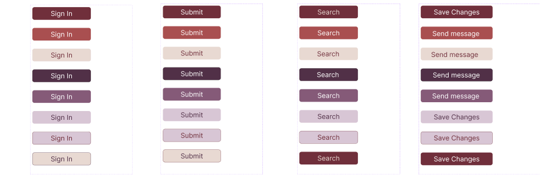
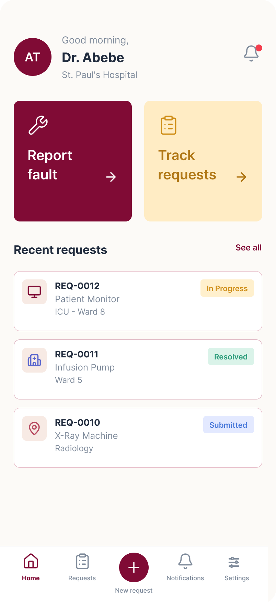
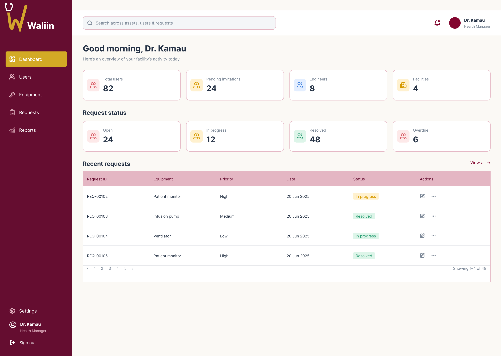

# Waliin Brand Guidelines

## Our Visual Identity

Waliin's visual identity creates a consistent and recognizable experience across its healthcare equipment management platform and technical documentation.

These guidelines define how the Waliin logo, colours, typography, imagery and interface components should be used.

Waliin is a healthcare equipment management system developed by Solvya. Its visual identity reflects clarity, consistency, professionalism and usability within healthcare environments.

## Brand Principles

### 1. Logo Integrity

The Waliin logo is the core visual identifier. Maintain sufficient clear space around it and never stretch, skew or distort its proportions.

### 2. Typography

Use highly legible typefaces and a consistent font hierarchy to create clear, scannable documentation and distinguish important system information.

### 3. Iconography

Use clean, consistent outline icons that communicate specific actions and operational behaviours.

### 4. Interface Consistency

Apply brand colours, buttons and typography consistently across interface components to support a responsive and accessible user experience.

---

## 1. Logo Usage

The Waliin logo is the primary visual identifier of the product. It represents the Waliin platform across its documentation and user interface.

### Official Waliin Logo

### Logo Usage Guidelines

- Use the official Waliin logo in its approved form.
- Maintain the original logo proportions.
- Preserve sufficient clear space around the logo.
- Never stretch, skew, rotate or distort the logo.
- Do not change the official logo colours without approval.
- Ensure sufficient contrast between the logo and its background.
- Keep the logo recognizable at different display sizes.

### Logo Application

The logo should be used consistently across the platform, documentation pages and relevant product materials.

---

## 2. Official Colors

Waliin uses a consistent colour palette to establish its visual identity and distinguish important interface elements.

### Official Colour Palette

### Primary Brand Colours

  

    

    <h3>Burgundy</h3>
    <code>#650D30</code>
    
Primary brand colour

  

  

    

    <h3>Gold</h3>
    <code>#D2A52C</code>
    
Accent colour

  

  

    

    <h3>Plum</h3>
    <code>#513047</code>
    
Secondary brand colour

  

### Colour Applications

| Colour | HEX code | Application |
|---|---|---|
| Burgundy | `#650D30` | Primary headers, navigation and important interface elements |
| Gold | `#D2A52C` | Accents, highlights and selected elements |
| Plum | `#513047` | Secondary backgrounds and supporting visual elements |

### Colour Usage Guidelines

- Apply Burgundy consistently to primary brand elements.
- Use Gold selectively to highlight important elements.
- Use Plum to complement the primary colour.
- Maintain sufficient contrast between text and backgrounds.
- Avoid introducing unrelated colours that weaken brand consistency.
- Use colours consistently across documentation and application interfaces.

---

## 3. Typography

Typography establishes a clear information hierarchy and makes the Waliin platform easy to read and navigate.

### Official Typography

### Primary Typeface

**Inter** is the primary typeface used throughout Waliin's documentation and interface.

### Typography Hierarchy

| Element | Typeface | Recommended weight |
|---|---|---|
| Main headings | Inter | Bold |
| Section headings | Inter | Semibold |
| Body text | Inter | Regular |
| Navigation | Inter | Medium |
| Code snippets | Roboto Mono | Regular |

### Typography Guidelines

- Use Inter consistently across the platform.
- Maintain a clear distinction between headings and body text.
- Use appropriate font weights to establish visual hierarchy.
- Keep paragraphs readable and well-spaced.
- Avoid unnecessary font variations.
- Ensure text remains readable across different screen sizes.

---

## 4. Imagery and Icons

Images and icons support communication, improve navigation and help users understand the platform's functionality.

### Iconography

Waliin uses clean and consistent icons to represent interface actions and operational behaviours.

### Icon Guidelines

- Use consistent outline icon styles.
- Select icons that clearly communicate their intended meaning.
- Use icons consistently for similar actions.
- Maintain appropriate icon sizing and alignment.
- Avoid unnecessary decorative icons.
- Ensure icons remain recognizable against their backgrounds.

### Imagery Guidelines

- Use relevant images that support the content.
- Prioritize clear and appropriate healthcare-related imagery.
- Preserve the original proportions of images.
- Avoid stretching or distorting image assets.
- Use descriptive alternative text for meaningful images.
- Maintain consistency in image presentation across documentation pages.

---

## 5. Example Application

This section demonstrates how the Waliin visual identity is applied within the platform interface.

The examples illustrate the relationship between brand colours, typography, buttons, icons and interface components.

### Buttons and Interface Elements

Buttons and interface elements should follow a consistent visual style.

### Application Example 1

### Application Example 2

### Interface Guidelines

- Use Burgundy for primary actions and important interface elements.
- Use Gold for accents and selected highlights.
- Use Plum for complementary interface elements.
- Maintain consistent button styling and spacing.
- Use clear labels for actions and navigation.
- Keep interface components visually consistent.
- Ensure layouts adapt to different screen sizes.
- Prioritize readability and accessibility.

---

## Brand Consistency

All Waliin documentation and interface materials should follow these guidelines.

The logo, colours, typography, imagery and interface components should work together to create a consistent product identity.

Any proposed changes to the official logo, colour palette or typography should be reviewed before adoption.

## Design Resources

The following Figma file contains the Waliin design reference, including the interface and visual design work.

### Waliin UI/UX Design

[Open Waliin Figma Design](https://www.figma.com/design/OH0KY8QlJKX1eZO3wz5D2y/Solvya?node-id=0-1&p=f)