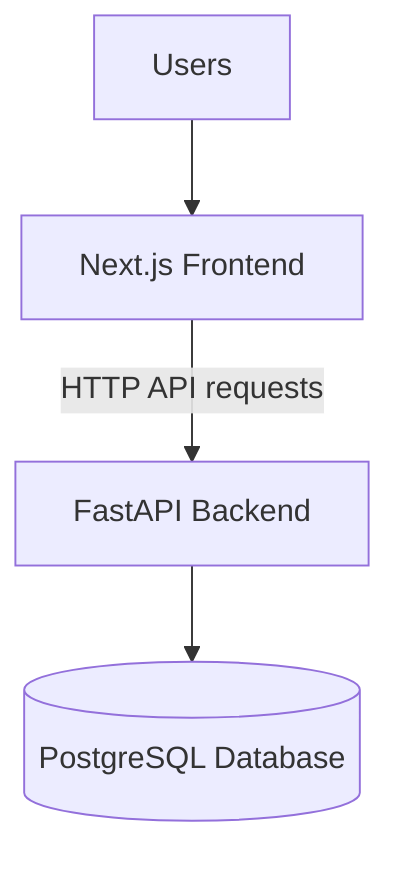

# Deployment Guide

## 1. Introduction

This guide describes the deployment considerations for Waliin, a healthcare equipment management system developed by Solvya.

Waliin consists of three main application layers:

- Next.js frontend
- FastAPI backend
- PostgreSQL database

Each layer must be configured correctly for the application to operate.

## 2. Deployment Architecture

The production deployment separates the frontend, backend API and database.

## 3. Deployment Prerequisites

| Requirement | Purpose |
|---|---|
| Node.js | Run the Next.js application |
| Python 3.11+ | Run the FastAPI backend |
| PostgreSQL | Store application data |
| Backend configuration | Configure application settings |
| Frontend configuration | Configure backend connectivity |
| Network connectivity | Allow communication between application layers |

## 4. Environment Configuration

The frontend supports:

- `BACKEND_URL` — backend server address.
- `BACKEND_API_PREFIX` — backend API prefix, defaulting to `/api/v1`.

The backend uses environment-based configuration for database connectivity and other application services.

Do not place passwords, secret keys or other sensitive credentials in source code or public documentation.

## 5. Backend Deployment

The backend is a FastAPI application initialized through `main.py`.

A typical deployment process includes:

1. Prepare the Python runtime environment.
2. Install the backend dependencies.
3. Configure the database connection and required environment variables.
4. Ensure PostgreSQL is available.
5. Apply database migrations using Alembic.
6. Start the FastAPI application using the selected ASGI server.
7. Verify that the `/health` endpoint responds successfully.

The health endpoint returns a status response indicating whether the application is responding.

## 6. Frontend Deployment

The frontend is a Next.js application.

A typical deployment process includes:

1. Install the Node.js dependencies.
2. Configure `BACKEND_URL` where required.
3. Configure `BACKEND_API_PREFIX` if the backend uses a different API prefix.
4. Build the application using `npm run build`.
5. Start the production application using `npm run start`.
6. Verify that the application can communicate with the backend.

## 7. Database Deployment

Waliin uses PostgreSQL as its persistent data store.

Database deployment considerations include:

- Provisioning a PostgreSQL database.
- Configuring database connection settings.
- Applying Alembic migrations.
- Maintaining appropriate database access permissions.
- Establishing a backup and recovery process.

## 8. Security Considerations

Production deployments should:

- Use HTTPS for application communication.
- Protect database credentials and secret keys.
- Restrict access to database services.
- Keep environment files outside public directories.
- Use secure session cookie settings.
- Apply appropriate access controls.
- Keep dependencies updated.

## 9. Monitoring and Maintenance

Deployment maintenance should include:

- Checking the backend health endpoint.
- Monitoring application logs.
- Monitoring database availability.
- Reviewing application errors.
- Applying database migrations carefully.
- Maintaining database backups.

## 10. Related Documentation

- [System Architecture](architecture.md)
- [Backend Documentation](backend-documentation.md)
- [Frontend Documentation](frontend-documentation.md)
- [Database Design](database-design.md)
- [Authentication and Security](authentication-and-security.md)
