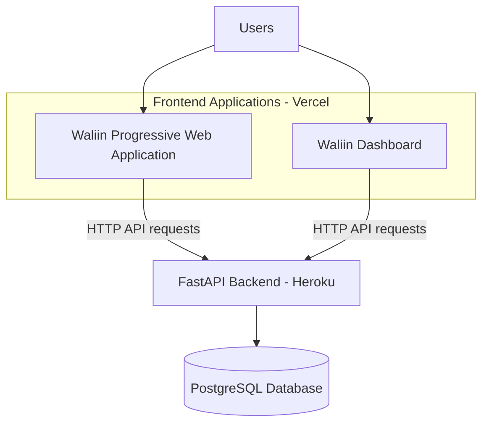

# Deployment Guide

## 1. Introduction

This guide describes the deployment architecture, environment configuration and deployment considerations for Waliin, a healthcare equipment management system developed by Solvya.

Waliin consists of three main application layers:

- Frontend applications.
- FastAPI backend.
- PostgreSQL database.

The frontend applications provide the user interfaces, the backend handles application logic and API requests, and PostgreSQL stores application data.

Each layer must be configured correctly for the system to operate.

### 1.1 Purpose

This document covers:

- Deployment architecture and hosting environments.
- Deployment prerequisites.
- Frontend and backend environment configuration.
- Backend deployment procedures.
- Frontend deployment procedures.
- Database deployment considerations.
- Production security considerations.
- Monitoring and maintenance.

Detailed application architecture, backend implementation, API specifications and database structures are documented separately.

## 2. Deployment Architecture

The production deployment separates the frontend applications, backend API and database.

The frontend applications are hosted through Vercel, while the backend API is deployed on Heroku.

### 2.1 Deployment Architecture Diagram



**Figure 1: Waliin deployment architecture.**

The frontend applications communicate with the backend through HTTP API requests. The backend processes these requests and interacts with PostgreSQL for persistent data storage.

### 2.2 Deployment Components

| Component | Technology | Hosting Environment |
|---|---|---|
| Waliin Progressive Web Application | Next.js | Vercel |
| Waliin Dashboard | Next.js | Vercel |
| Backend API | Python and FastAPI | Heroku |
| Database | PostgreSQL | Configured database hosting environment |

## 3. Deployment Prerequisites

The following requirements support the deployment and operation of Waliin.

| Requirement | Purpose |
|---|---|
| Node.js | Run and build the Next.js applications |
| Python 3.11+ | Run the FastAPI backend |
| PostgreSQL | Store application data |
| Backend configuration | Configure application settings |
| Frontend configuration | Configure backend connectivity |
| Network connectivity | Allow communication between application layers |
| Git | Manage application source code |

The hosting environments must support the runtime requirements of their respective applications.

## 4. Environment Configuration

Waliin uses environment variables to configure application connectivity and runtime settings.

Environment-specific configuration allows the applications to operate across development and production environments without placing sensitive values directly in source code.

### 4.1 Frontend Configuration

The frontend supports the following environment variables:

| Variable | Purpose |
|---|---|
| `BACKEND_URL` | Backend server address |
| `BACKEND_API_PREFIX` | Backend API prefix, defaulting to `/api/v1` |

These settings allow the Next.js application to communicate with the deployed FastAPI backend.

The values must correspond to the backend deployment and API configuration.

### 4.2 Backend Configuration

The backend uses environment-based configuration for database connectivity and other application services.

Configuration includes:

- Application environment settings.
- Database connection settings.
- Session duration and cookie configuration.
- MFA encryption and issuer settings.
- Frontend and dashboard base URLs.
- Email backend and SMTP configuration.

Sensitive configuration values must be supplied through the hosting environment.

Do not place passwords, encryption keys, database credentials or other sensitive information in source code or public documentation.

### 4.3 Environment Configuration Management

Before deployment:

1. Identify the configuration values required by each application.
2. Set the appropriate values in the hosting environment.
3. Verify that frontend configuration points to the correct backend.
4. Verify that backend configuration points to the intended database.
5. Ensure sensitive values are not committed to version control.

## 5. Backend Deployment

The backend is a FastAPI application initialized through `main.py`.

The backend deployment process includes:

1. Prepare the Python runtime environment.
2. Install the backend dependencies.
3. Configure the database connection and required environment variables.
4. Ensure PostgreSQL is available.
5. Apply database migrations using Alembic.
6. Start the FastAPI application using the selected ASGI server.
7. Verify that the `/health` endpoint responds successfully.

### 5.1 Backend Process Configuration

The backend includes a `Procfile` defining its web process:

```bash
web: uvicorn main:app --host 0.0.0.0 --port $PORT
```

This command starts the FastAPI application using Uvicorn and binds the application to the port provided by the hosting environment.

### 5.2 Database Migration

Alembic manages database schema changes.

Before deploying application changes that require database updates:

1. Review the migration files.
2. Verify that the migrations represent the intended schema changes.
3. Ensure the target database is available.
4. Apply the migrations.
5. Verify that the application can access the updated database schema.

### 5.3 Backend Deployment Verification

After deployment, verify the following:

- The backend application starts successfully.
- The `/health` endpoint responds successfully.
- The deployed API documentation is accessible.
- The backend can establish its database connection.
- The frontend applications can communicate with the backend.

The health endpoint returns a status response indicating whether the application is responding.

The deployed backend also exposes interactive API documentation through Swagger UI.

## 6. Frontend Deployment

The Waliin frontend applications are built using Next.js and hosted through Vercel.

The deployment process includes:

1. Install the Node.js dependencies.
2. Configure `BACKEND_URL` where required.
3. Configure `BACKEND_API_PREFIX` if the backend uses a different API prefix.
4. Build the application using `npm run build`.
5. Start the production application using `npm run start`, where applicable to the hosting environment.
6. Verify that the application can communicate with the backend.

### 6.1 Frontend Deployment Verification

After deployment, verify the following:

- The frontend application loads successfully.
- Application routes are accessible.
- The frontend can communicate with the deployed backend.
- API requests return the expected responses.
- Application functionality is accessible to the appropriate user roles.

The Waliin Progressive Web Application and Dashboard are deployed as separate frontend applications.

## 7. Database Deployment

Waliin uses PostgreSQL as its persistent data store.

Database deployment considerations include:

- Provisioning a PostgreSQL database.
- Configuring database connection settings.
- Applying Alembic migrations.
- Maintaining appropriate database access permissions.
- Restricting database network access.
- Establishing a backup and recovery process.

### 7.1 Database Schema Management

Alembic manages database schema changes through versioned migration files.

The migration configuration is maintained through:

- `alembic.ini`
- `alembic/env.py`
- Versioned migration files.

Before applying migrations in production, developers should review the migration and verify that it represents the intended schema changes.

### 7.2 Backup and Recovery

A database backup and recovery process should be established for the production environment.

The process should account for:

- Regular database backups.
- Secure backup storage.
- Appropriate backup access permissions.
- Recovery procedures.
- Periodic verification that backups can be restored.

## 8. Security Considerations

Production deployments should follow appropriate security practices.

The following considerations apply:

- Use HTTPS for application communication.
- Protect database credentials and encryption keys.
- Restrict access to database services.
- Keep environment files outside public directories.
- Use secure session cookie settings.
- Apply appropriate backend access controls.
- Keep dependencies updated.
- Avoid exposing sensitive information in application logs.
- Review access permissions for uploaded documents and generated reports.

Security configuration should be reviewed before deploying application changes to production.

Detailed authentication mechanisms, session management and application security controls are documented in Authentication and Security.

## 9. Monitoring and Maintenance

Deployment maintenance should include:

- Checking the backend health endpoint.
- Monitoring application logs.
- Monitoring database availability.
- Reviewing application errors.
- Applying database migrations carefully.
- Maintaining database backups.
- Reviewing application configuration.
- Checking frontend and backend connectivity.

Regular maintenance helps identify deployment issues and maintain application availability.

### 9.1 Deployment Verification Checklist

The following checklist can be used after a deployment:

- [ ] Frontend applications load successfully.
- [ ] Backend API is accessible.
- [ ] Backend health endpoint responds successfully.
- [ ] Database connectivity is working.
- [ ] Required migrations have been applied.
- [ ] Frontend API requests reach the backend.
- [ ] Authentication and access restrictions work as expected.
- [ ] File upload and retrieval functionality works as expected.
- [ ] Application logs are accessible for troubleshooting.

## 10. Deployed Application Resources

The following links provide access to the deployed Waliin applications and backend services.

### 10.1 Waliin Progressive Web Application

The Waliin PWA provides users with access to the system's equipment management workflows.

[Open Waliin PWA](https://waliin-solvya.vercel.app/home)

### 10.2 Waliin Dashboard

The Waliin Dashboard provides the management interface for accessing administrative and equipment-management functionality.

[Open Waliin Dashboard](https://waliin.vercel.app/)

### 10.3 Waliin Backend API

The backend API is deployed on Heroku.

[Open Waliin Swagger UI](https://waliin-8c96dd4bd190.herokuapp.com/docs)

### 10.4 Solvya Informational Website

The informational website introduces Solvya and provides an overview of its work and solutions.

[Visit Solvya Website](https://solvya-website-lilac.vercel.app/)

## 11. Related Documentation

- [System Architecture](architecture.md)
- [Backend Documentation](backend-documentation.md)
- [Frontend Documentation](frontend-documentation.md)
- [API Reference](api-reference.md)
- [Database Design](database-design.md)
- [Authentication and Security](authentication-and-security.md)
- [Developer Guide](developer-guide.md)
- [Testing](testing.md)
