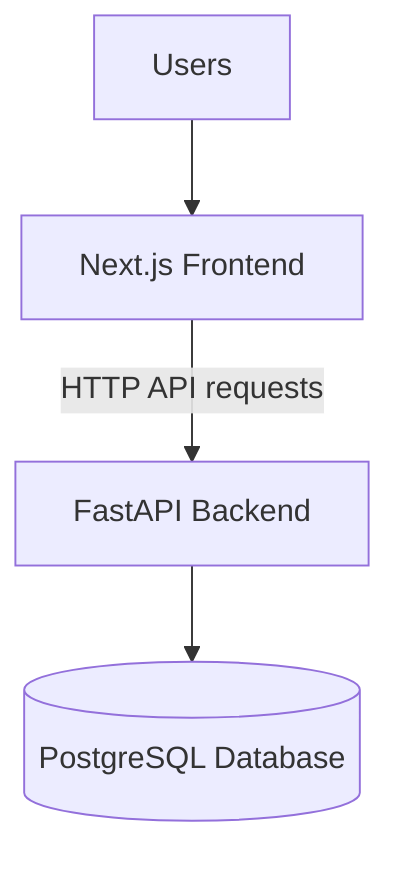

# Deployment Guide

## 1. Introduction

This guide describes the deployment architecture and considerations for Waliin, a healthcare equipment management system developed by Solvya.

Waliin consists of three main application layers:

- Next.js frontend
- FastAPI backend
- PostgreSQL database

Each layer must be configured correctly for the application to operate.

The frontend provides the user interface, the backend handles application logic and API requests, and PostgreSQL stores application data.

## 2. Deployment Architecture

The production deployment separates the frontend, backend API and database.



The frontend communicates with the backend through HTTP API requests. The backend processes these requests and interacts with PostgreSQL for persistent data storage.

## 3. Deployment Prerequisites

| Requirement | Purpose |
|---|---|
| Node.js | Run and build the Next.js application |
| Python 3.11+ | Run the FastAPI backend |
| PostgreSQL | Store application data |
| Backend configuration | Configure application settings |
| Frontend configuration | Configure backend connectivity |
| Network connectivity | Allow communication between application layers |
| Git | Manage application source code |

The hosting environments must support the runtime requirements of their respective applications.

## 4. Environment Configuration

### 4.1 Frontend Configuration

The frontend supports the following environment variables:

| Variable | Purpose |
|---|---|
| `BACKEND_URL` | Backend server address |
| `BACKEND_API_PREFIX` | Backend API prefix, defaulting to `/api/v1` |

These settings allow the Next.js application to communicate with the deployed FastAPI backend.

### 4.2 Backend Configuration

The backend uses environment-based configuration for database connectivity and other application services.

Configuration includes:

- Application environment settings.
- Database connection settings.
- Session duration and cookie configuration.
- MFA encryption and issuer settings.
- Frontend and dashboard base URLs.
- Email backend and SMTP configuration.

Sensitive configuration values must be supplied through the hosting environment.

Do not place passwords, encryption keys, database credentials or other sensitive information in source code or public documentation.

## 5. Backend Deployment

The backend is a FastAPI application initialized through `main.py`.

The backend deployment process includes:

1. Prepare the Python runtime environment.
2. Install the backend dependencies.
3. Configure the database connection and required environment variables.
4. Ensure PostgreSQL is available.
5. Apply database migrations using Alembic.
6. Start the FastAPI application using the selected ASGI server.
7. Verify that the `/health` endpoint responds successfully.

The backend includes a `Procfile` defining its web process:

```bash
web: uvicorn main:app --host 0.0.0.0 --port $PORT
```

The health endpoint returns a status response indicating whether the application is responding.

The deployed backend also exposes interactive API documentation through Swagger UI.

## 6. Frontend Deployment

The frontend is a Next.js application.

The deployment process includes:

1. Install the Node.js dependencies.
2. Configure `BACKEND_URL` where required.
3. Configure `BACKEND_API_PREFIX` if the backend uses a different API prefix.
4. Build the application using `npm run build`.
5. Start the production application using `npm run start`, where applicable to the hosting environment.
6. Verify that the application can communicate with the backend.

The deployed frontend applications are hosted through Vercel.

## 7. Database Deployment

Waliin uses PostgreSQL as its persistent data store.

Database deployment considerations include:

- Provisioning a PostgreSQL database.
- Configuring database connection settings.
- Applying Alembic migrations.
- Maintaining appropriate database access permissions.
- Restricting database network access.
- Establishing a backup and recovery process.

Alembic manages database schema changes through versioned migration files.

Before applying migrations in production, developers should review the migration and verify that it represents the intended schema changes.

## 8. Security Considerations

Production deployments should:

- Use HTTPS for application communication.
- Protect database credentials and encryption keys.
- Restrict access to database services.
- Keep environment files outside public directories.
- Use secure session cookie settings.
- Apply appropriate backend access controls.
- Keep dependencies updated.
- Avoid exposing sensitive information in application logs.
- Review access permissions for uploaded documents and generated reports.

Security configuration should be reviewed before deploying application changes to production.

## 9. Monitoring and Maintenance

Deployment maintenance should include:

- Checking the backend health endpoint.
- Monitoring application logs.
- Monitoring database availability.
- Reviewing application errors.
- Applying database migrations carefully.
- Maintaining database backups.
- Reviewing application configuration.
- Checking frontend and backend connectivity.

Regular maintenance helps identify deployment issues and maintain application availability.

## 10. Deployed Application Resources

The following links provide access to the deployed Waliin applications and backend services.

### 10.1 Waliin Progressive Web Application

The Waliin PWA provides users with access to the system's equipment management workflows.

[Open Waliin PWA](https://waliin-solvya.vercel.app/home)

### 10.2 Waliin Dashboard

The Waliin Dashboard provides the management interface for accessing administrative and equipment-management functionality.

[Open Waliin Dashboard](https://waliin.vercel.app/)

### 10.3 Waliin Backend API

The backend API is deployed on Heroku.

[Open Waliin Swagger UI](https://waliin-8c96dd4bd190.herokuapp.com/docs)

### 10.4 Solvya Informational Website

The informational website introduces Solvya and provides an overview of its work and solutions.

[Visit Solvya Website](https://solvya-website-lilac.vercel.app/)

## 11. Related Documentation

- [System Architecture](architecture.md)
- [Backend Documentation](backend-documentation.md)
- [Frontend Documentation](frontend-documentation.md)
- [API Reference](api-reference.md)
- [Database Design](database-design.md)
- [Authentication and Security](authentication-and-security.md)
- [Developer Guide](developer-guide.md)
- [Testing](testing.md)
