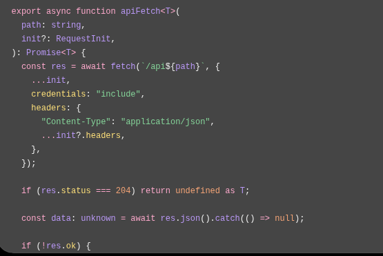

# Frontend Documentation

## 1. Introduction

Waliin's frontend consists of web applications developed using Next.js, React and TypeScript.

The frontend provides the user interfaces through which healthcare professionals interact with the system's equipment management functionality.

The frontend uses the Next.js App Router and communicates with the FastAPI backend through HTTP API requests.

Waliin provides separate user-facing interfaces for clinical staff, biomedical engineers and health managers. The available interface and navigation depend on the user's role.

### 1.1 Purpose

This document describes the frontend implementation, including:

- Frontend technologies and project structure.
- Application initialization and routing.
- Authentication integration.
- API communication with the backend.
- Shared interface components.
- Equipment management interfaces.
- Styling and frontend testing.

Backend implementation, API specifications, database structures and deployment procedures are documented separately.

## 2. Technology Stack

The frontend uses the following technologies and libraries.

| Technology | Version | Purpose |
|---|---|---|
| Next.js | 16.4.3 | Frontend framework |
| React | 19.3.0 | User interface library |
| TypeScript | 5.x | Frontend programming language |
| Tailwind CSS | 4.x | Styling framework |
| React Hook Form | 7.x | Form management |
| Lucide React | 1.x | Interface icons |
| Vitest | 5.x | Testing framework |
| ESLint | 9.x | Code quality checks |

## 3. Frontend Project Structure

The frontend project organizes its implementation into application routes, reusable components and shared utilities.

### 3.1 Main Directories

| Directory | Responsibility |
|---|---|
| `app/` | Application routes and page components |
| `app/shared-paths/` | Shared header and sidebar components |
| `components/` | Reusable interface components |
| `lib/` | API client, authentication and application utilities |
| `public/` | Static application assets |

**Frontend implementation reference:**

<small>Figure 1: Frontend application implementation reference.</small>

### 3.2 Application Entry Points

The root layout is defined in `app/layout.tsx`.

It configures:

- Application-wide layout.
- Inter font.
- Page metadata.
- Document language.
- Browser theme colour.
- Global styles.

The application uses `globals.css` for global styling and Tailwind CSS utilities.

## 4. Authentication Integration

The frontend uses shared authentication utilities defined in `lib/auth.ts`.

The authentication functionality includes:

- User login.
- Current-user retrieval.
- Logout.
- Password reset requests.
- Password reset completion.
- Invitation acceptance.
- Multi-factor authentication setup and verification.

### 4.1 User Roles

The frontend recognizes three user roles:

| Role | Description |
|---|---|
| `health_manager` | Health management user |
| `biomedical_engineer` | Biomedical engineering user |
| `clinical_staff` | Clinical staff user |

### 4.2 Authentication State

The `UserProfileProvider` provides user profile information through React context.

It retrieves the current user through the backend authentication API and exposes user information to application components.

This allows application components to access the current user's profile and role information.

The frontend uses this information to support role-dependent navigation and interface presentation.

Authentication and authorization are ultimately enforced by the backend.

## 5. API Integration

The shared API client is implemented in:

`lib/api/client.ts`

The main function is `apiFetch<T>()`.

Its responsibilities include:

- Sending requests to the frontend `/api` route.
- Including browser credentials.
- Setting JSON request headers.
- Parsing JSON responses.
- Handling HTTP errors.
- Returning `undefined` for HTTP 204 responses.

### 5.1 API Errors

The frontend defines an `ApiError` class that extends JavaScript's `Error` class.

It includes an HTTP status code to help application components handle failed API requests.

### 5.2 Backend Connectivity

The Next.js configuration supports:

- `BACKEND_URL`
- `BACKEND_API_PREFIX`

When `BACKEND_URL` is configured, the application can rewrite frontend `/api` requests to the configured backend API.

This provides a shared communication path between the frontend and FastAPI backend.

## 6. Application Routes

The frontend uses the Next.js App Router to organize application pages and navigation.

The following application routes are present in the project:

| Route | Purpose |
|---|---|
| `/login` | User login |
| `/forgot-password` | Password reset request |
| `/reset-password/[token]` | Password reset |
| `/accept-invite` | Invitation acceptance |
| `/get-started` | Getting started |
| `/onboarding` | User onboarding |
| `/continue-as` | Continue-as flow |
| `/biomedical-engineer/dashboard` | Biomedical engineer dashboard |
| `/biomedical-engineer/equipment` | Equipment management |
| `/biomedical-engineer/equipment/list` | Equipment listing |
| `/biomedical-engineer/register-equipment` | Equipment registration |
| `/biomedical-engineer/faults` | Fault management |
| `/biomedical-engineer/faults/[faultId]` | Fault details |

These routes represent documented application pages and are not an exhaustive list of every possible frontend route.

## 7. Shared Interface Components

The frontend includes shared interface components to maintain consistent navigation and user information across application pages.

### 7.1 Header

The shared header provides:

- Search input.
- Notifications control.
- User profile information.
- User initials and role information.

### 7.2 Sidebar

The biomedical engineer sidebar provides navigation links for:

- Dashboard.
- Equipment.
- Maintenance.
- Requests.
- Reports.
- Settings.

The sidebar uses the current route to determine the active navigation item.

## 8. Equipment Management Interface

The biomedical engineer interface includes equipment registration and management functionality.

Equipment registration components include:

- `EquipmentDetails`
- `LocationSpecs`
- `PhotoDocs`
- `RegistrationMethod`
- `ReviewDetails`
- `SuccessState`
- `CsvEquipmentImport`

These components support the equipment registration workflow, including equipment details, location information, document uploads, review and CSV import functionality.

The registration workflow organizes equipment information into separate components to support data entry and review.

## 9. Frontend Styling

The frontend uses Tailwind CSS 4 and global styles defined in `app/globals.css`.

The global styling defines:

- Inter typography.
- Application background and foreground colours.
- Brand colour variables.
- Shared visual styling.

Tailwind CSS utilities are used alongside global styles to maintain consistent interface layouts and component presentation.

## 10. Testing and Build Commands

The frontend provides the following npm scripts:

| Command | Purpose |
|---|---|
| `npm run dev` | Start development server |
| `npm run build` | Build production application |
| `npm run start` | Start production server |
| `npm run lint` | Run ESLint |
| `npm run test` | Run Vitest |
| `npm run format:check` | Check code formatting |
| `npm run format` | Format project files |

These commands support local development, production builds, testing and code quality checks.

## 11. Related Documentation

- [System Architecture](architecture.md)
- [API Reference](api-reference.md)
- [Backend Documentation](backend-documentation.md)
- [Database Design](database-design.md)
- [Authentication and Security](authentication-and-security.md)
- [Developer Guide](developer-guide.md)
- [Deployment Guide](deployment-guide.md)
- [Testing](testing.md)

## 12. Frontend Application Resources

The following links provide access to the deployed Waliin frontend applications and the Solvya informational website.

### 12.1 Progressive Web Application (PWA)

The Waliin PWA provides users with access to key equipment management functions, including equipment-related workflows and fault reporting.

[Open Waliin PWA](https://waliin-solvya.vercel.app/home)

### 12.2 Waliin Dashboard

The Waliin Dashboard provides the management interface for accessing the system's administrative and equipment-management functionality.

[Open Waliin Dashboard](https://waliin.vercel.app/)

### 12.3 Solvya Informational Website

The informational website introduces Solvya and provides an overview of its work and solutions.

[Visit Solvya Website](https://solvya-website-lilac.vercel.app/)
