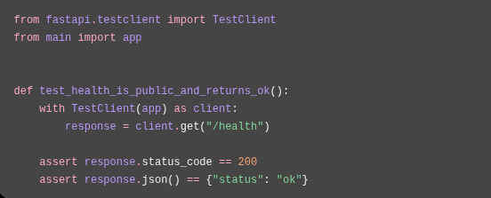

# Testing

## 1. Introduction

Testing helps verify that Waliin behaves as expected and that changes do not introduce unintended problems.

Waliin has separate frontend and backend projects, each with its own testing and quality-check tools.

This document describes the testing tools, commands, functional areas and verification workflows used during the development of Waliin.

## 2. Documentation and Testing Scope

Testing was conducted in the individual Waliin application repositories, covering both frontend and backend functionality.

The frontend and backend repositories maintain their respective test suites and quality-check tools. Testing was performed within these repositories to verify application functionality, identify issues and assess code quality.

This documentation consolidates the testing tools, commands, functional areas and verification workflows used during the development process.

The results documented should reflect the actual tests and checks performed in the respective application repositories.

A distinction is maintained between:

- **Automated testing:** Tests executed through the frontend and backend testing frameworks.
- **Code quality checks:** Linting, formatting and build checks.
- **Manual verification:** Direct examination of application behaviour and user workflows.

## 3. Frontend Testing

The frontend uses Vitest as its test runner.

The `package.json` file defines the following test command:

```bash
npm run test
```

This runs:

```bash
vitest run --passWithNoTests
```

The `--passWithNoTests` option allows the test command to complete successfully when no test files are present. A successful command therefore does not necessarily indicate that frontend tests were executed.

### 3.1 Frontend Quality Checks

The frontend also provides additional quality-check commands:

| Command | Purpose |
|---|---|
| `npm run test` | Run frontend tests |
| `npm run lint` | Run ESLint |
| `npm run format:check` | Check code formatting |
| `npm run format` | Format project files |
| `npm run build` | Build the Next.js application |

The frontend test suite supports verification of individual application components and functionality where corresponding tests are available.

### 3.2 Frontend Verification Areas

Frontend verification should cover:

- Page rendering and navigation.
- Form validation.
- User authentication flows.
- API request and response handling.
- Loading and error states.
- Role-oriented navigation.
- Equipment registration and management workflows.
- Fault reporting and repair-related workflows.

These areas describe recommended verification coverage and should not be interpreted as evidence that every workflow has an automated test.

## 4. Backend Testing

The backend uses pytest for automated testing.

Ruff is used for Python code-quality checks.

### 4.1 Running Backend Tests

From the backend project directory, run:

```bash
uv run --active pytest -q
```

To run tests from the test directory:

```bash
uv run --active pytest tests/
```

To run tests for a specific area:

```bash
uv run --active pytest tests/equipment_tests/
```

The test directories cover different backend functionality.

### 4.2 Backend Test Organization

The backend test directories include:

| Directory | Testing Focus |
|---|---|
| `auth_tests/` | Authentication functionality |
| `equipment_tests/` | Equipment-related functionality |
| `model_tests/` | Database model functionality |
| `security_tests/` | Security-related functionality |
| `session_tests/` | Session management functionality |

### 4.3 Backend Code Quality Checks

Run Ruff to check Python code quality:

```bash
uv run ruff check .
```

Ruff supports the identification of code-quality issues and helps maintain consistent Python code.

### 4.4 Backend Test Implementation Reference

The following image illustrates a backend health-check testing example.



<small>Figure 1: Backend health-check test implementation reference.</small>

These tools support verification of backend functionality, expected application behaviour and code consistency.

## 5. Functional Testing Scope

Testing activities should cover the main functional areas of Waliin.

The following areas provide recommended verification coverage.

### 5.1 Authentication

Verify:

- User login and logout.
- Current-user retrieval.
- Invitation acceptance.
- Password reset operations.
- Multi-factor authentication operations.
- Session handling and authentication requirements.

### 5.2 Equipment Management

Verify:

- Equipment registration.
- Equipment retrieval and updates.
- Equipment approval and return operations.
- Equipment document handling.
- CSV equipment import.

### 5.3 Fault and Repair Management

Verify:

- Fault creation and retrieval.
- Fault assignment and status updates.
- Fault assessments.
- Repair records and tests.
- Equipment release operations.
- Repair verification records.

### 5.4 Maintenance Reporting

Verify:

- Maintenance summary retrieval.
- Maintenance summary PDF generation.

### 5.5 Notifications and Resource Requests

Verify:

- Notification retrieval and relevant status updates.
- Resource request creation and retrieval.
- Request item management.
- Request follow-up operations.

## 6. API Verification

Backend API endpoints should be checked for:

- Expected HTTP status codes.
- Valid request and response data.
- Appropriate error responses.
- Authentication requirements.
- Role-based access restrictions.
- Correct database interactions.
- Appropriate handling of invalid or missing data.

API verification can be performed through automated backend tests and the interactive Swagger UI.

[Open Waliin Swagger UI](https://waliin-8c96dd4bd190.herokuapp.com/docs)

## 7. Manual Application Verification

Manual verification complements automated testing by checking application behaviour through the user interfaces.

### 7.1 Frontend Verification

Frontend verification should confirm that:

- Application pages render correctly.
- Navigation leads to the expected pages.
- Forms accept valid information and handle invalid input appropriately.
- Authentication flows behave as expected.
- Loading and error states are communicated clearly.
- Role-dependent navigation presents the appropriate interface.
- Equipment registration and management workflows behave as expected.
- Fault reporting and repair-related workflows communicate correctly with the backend.

### 7.2 Backend and API Verification

Backend and API verification should confirm that:

- API endpoints return the expected responses.
- Request validation handles invalid data appropriately.
- Authentication and authorization requirements are enforced.
- Database operations produce the expected results.
- Error responses communicate relevant information.
- File-related operations handle supported uploads and downloads.

Manual verification should be recorded separately from automated test results.

## 8. Testing Workflow

A typical verification workflow is:

1. Identify the functionality being changed.
2. Review the relevant frontend and backend code.
3. Run the relevant automated tests.
4. Run linting and formatting checks.
5. Build the frontend when frontend code changes.
6. Perform manual verification of the affected application functionality.
7. Document any known issues.

### 8.1 Recommended Verification Commands

**Backend**

```bash
uv run --active pytest -q
uv run ruff check .
```

**Frontend**

```bash
npm run test
npm run lint
npm run format:check
npm run build
```

Run the relevant checks from the respective project directories.

## 9. Test Reporting

Testing results should record:

- The tests or checks performed.
- The result of each test run.
- Any failures or warnings.
- Known issues that remain unresolved.
- Relevant changes made to address identified problems.

Test results should reflect actual execution.

A successful build or lint check should not be reported as evidence that all application workflows have been tested.

Similarly, a successful test command that executes no tests should not be reported as evidence of successful functional test coverage.

### 9.1 Reporting Test Results

When documenting test results, distinguish between:

| Result Type | What It Demonstrates |
|---|---|
| Tests passed | The executed tests completed successfully. |
| Tests failed | One or more executed tests did not pass. |
| Tests skipped | Tests were not executed because of configured skip conditions. |
| No tests collected | No matching tests were found for execution. |
| Linting passed | The configured linting checks completed successfully. |
| Build passed | The application production build completed successfully. |
| Manual verification passed | The specific manually checked workflow behaved as expected. |

These results should be reported independently rather than combined into a general claim that the entire application has been tested.

## 10. Related Documentation

- [Developer Guide](developer-guide.md)
- [Deployment Guide](deployment-guide.md)
- [Frontend Documentation](frontend-documentation.md)
- [Backend Documentation](backend-documentation.md)
- [API Reference](api-reference.md)
- [Database Design](database-design.md)
- [Authentication and Security](authentication-and-security.md)
- [System Architecture](architecture.md)
